# Money, Interdependencies and the Ecosystem: Hybrid Stock-Flow Consistent Models in `R`

These lectures are delivered at the [Central University of Finance and Economics](https://www.cufe.edu.cn/) (CUFE), Beijing, in December 2026, as part of the *International Scholar Project*.

*Last update: 24 November 2026.*

<div align="center">
<figure>

</figure>
</div>

## Overview

This repository presents a **family of small macroeconomic models** built around a single benchmark Stock-Flow Consistent (SFC) model, which we call **SBM** (**S**tate and **B**ank **M**oney). Model SBM combines the two simplest monetary economies of [Godley and Lavoie (2007)](#references), after Model **SIM**: Model **PC**, where money is issued by the state, and Model **BMW**, where money is created by private banks when they lend to firms. SBM is then extended in three *hybrid* directions: **input-output** (industries and prices), **ecological** (energy, emissions, matter and climate) and **agent-based** (heterogeneous households).

#### Table 1. The family of models

|                              | **Closed economy** | **Open economy** |
|:-----------------------------|:------------------:|:----------------:|
| **Aggregate**                | [1a. Model SBM](1a_SBM.R) | Model OPENSBM: <br> [1b. fixed exchange rate](1b_OPENSBM_FIX.R) · [1c. flexible exchange rate](1c_OPENSBM_FLEX.R) |
| **Input-output**             | Model IO-SBM: <br> [2a. fixed prices](2a_IO_SBM.R) · [2b. Sraffa-like prices](2b_IO_SBM_SRAFFA.R) | Model IO-OPENSBM: <br> [2c. fixed prices](2c_IO_OPENSBM.R) · [2d. Sraffa-like prices](2d_IO_OPENSBM_SRAFFA.R) |
| **Ecological (input-output)** | [3a. Model ECO-IO-SBM](3a_ECO_IO_SBM_CLIMATE.R) (climate block) <br> [3b. Model ECO-IO-SBM-FULL](3b_ECO_IO_SBM_FULL.R) (full block) | [3c. Model ECO-IO-OPENSBM](3c_ECO_IO_OPENSBM_CLIMATE.R) (climate block) <br> [3d. Model ECO-IO-OPENSBM-FULL](3d_ECO_IO_OPENSBM_FULL.R) (full block) |
| **Agent-based**              | [4a. Model ABM-SBM](4a_ABM_SBM.R) | [4b. Model ABM-OPENSBM](4b_ABM_OPENSBM.R) |

The models are listed in Table 1. Reading down a column shows how the *same* economy can be represented at increasing levels of detail: as economy-wide aggregates, as a set of interconnected **industries**, as an economy embedded in the **ecosystem**, and as a population of heterogeneous interacting **agents** (here, households). Reading across a row shows what changes when the economy trades with the rest of the world, under a fixed or a flexible exchange rate. The input-output model comes with two alternative *closures* of the price system: fixed prices, or Sraffa-like (cost-plus) prices that may diverge temporarily from their reproduction values when demand grows. Similarly, the ecological model comes in two versions: a climate block only, or a full block that also tracks matter, waste and the depletion of natural reserves. Each script is obtained from the previous one by adding a block of equations (and, where needed, modifying a few existing ones), so that the cost and the consequences of every extension can be seen directly in the code. Finally, Section 6 gives some hints on how the coefficients of these models can be calibrated and estimated on real-world data.

Sections 3.4, 4.3, 4.4, 5.3 and 6 are **extra material** (marked 📚): they extend the models of the previous sections or, in the case of Section 6, discuss how to calibrate and estimate them, and can be skipped on a first reading.

- [1 - Introduction](#1---introduction)
  - [1.1 - Getting started with `R` and `RStudio`](#11---getting-started-with-r-and-rstudio)
  - [1.2 - Stock-flow consistent models](#12---stock-flow-consistent-models)
  - [1.3 - From toy models to SBM](#13---from-toy-models-to-sbm)
- [2 - Aggregate models](#2---aggregate-models)
  - [2.1 - Model SBM](#21---model-sbm)
  - [2.2 - The open economy: Model OPENSBM-FLEX](#22---the-open-economy-model-opensbm-flex)
- [3 - Input-output models](#3---input-output-models)
  - [3.1 - IO models and why to combine them with SFC models](#31---io-models-and-why-to-combine-them-with-sfc-models)
  - [3.2 - Model IO-SBM with fixed prices](#32---model-io-sbm-with-fixed-prices)
  - [3.3 - Closing the price system: Sraffa-like prices](#33---closing-the-price-system-sraffa-like-prices)
  - [3.4 - Open-economy versions](#34---open-economy-versions) 📚
- [4 - Ecological models](#4---ecological-models)
  - [4.1 - Ecological macroeconomics and ecological SFC models](#41---ecological-macroeconomics-and-ecological-sfc-models)
  - [4.2 - Model ECO-IO-SBM: the climate block](#42---model-eco-io-sbm-the-climate-block)
  - [4.3 - Model ECO-IO-SBM-FULL: the full ecological block](#43---model-eco-io-sbm-full-the-full-ecological-block) 📚
  - [4.4 - Open-economy versions](#44---open-economy-versions) 📚
- [5 - Agent-based models](#5---agent-based-models)
  - [5.1 - Agent-based models and AB-SFC models](#51---agent-based-models-and-ab-sfc-models)
  - [5.2 - Model ABM-SBM](#52---model-abm-sbm)
  - [5.3 - Model ABM-OPENSBM](#53---model-abm-opensbm) 📚
- [6 - Calibration and estimation](#6---calibration-and-estimation) 📚
  - [6.1 - The SFC block](#61---the-sfc-block)
  - [6.2 - The IO block](#62---the-io-block)
  - [6.3 - Agent-based models: moment matching](#63---agent-based-models-moment-matching)
- [7 - Concluding remarks](#7---concluding-remarks)
- [References](#references)

All code has been developed for an `R` environment and is available in this repository. Similar lectures and further material of interest are available in these companion repositories:
- [Leeds lectures, 2026](https://github.com/marcoverpas/Leeds_lectures_2026) - nine small models (SIM, PC and BMW, each in aggregate, input-output and agent-based form), which these lectures extend (NARTI training seminar, University of Leeds).
- [Six lectures on SFC models, 2023](https://github.com/marcoverpas/Six_lectures_on_sfc_models) - a broad introduction to the whole SFC family, from the basic PC and BMW toy models to multi-country, input-output, ecological, and empirically-calibrated versions (six online lectures for CUFE, Beijing).
- [EAEPE Summer School, 2024](https://github.com/marcoverpas/EAEPE_summer_school_2024) - a hands-on introduction to ecological SFC models (17th EAEPE Summer School, Roma Tre University).
- [PhD Lectures, Macerata 2025](https://github.com/marcoverpas/PhD_Lectures_Macerata_2025) - doctoral lectures linking Graziani's monetary circuit theory to SFC modelling (University of Macerata).
- [Keynote speech, Florence, 2025](https://github.com/marcoverpas/keynote_speech_Florence) - how to extend SFC models with ecological variables (matter, energy, emissions, temperature) to analyse the low-carbon transition (University of Florence).
- [Analisi Economica](https://github.com/marcoverpas/analisi_economica) - lecture notes on production, distribution, conflict and money, from the classical surplus approach and Sraffa's price system to modern modelling developments (in Italian, University of L'Aquila).

:robot: *These lectures were prepared with the assistance of Claude (Anthropic).*

:unlock: :copyright: *Note*: Except where otherwise credited, all the material in this repository is licensed under [CC BY-NC 4.0](https://creativecommons.org/licenses/by-nc/4.0/?ref=chooser-v1). You are encouraged to use it for non-commercial purposes, provided that proper credit is given.

---

## 1 - Introduction

### 1.1 - Getting started with `R` and `RStudio`

**Installing the software.** All the models presented below are written in [`R`](https://www.r-project.org/), a free programming language for statistical computing that has become the standard environment for SFC modelling. We recommend using it through [`RStudio`](https://posit.co/download/rstudio-desktop/), a free integrated development environment (IDE) that makes it easier to write, run and debug code. Installation takes two steps, in this order:

1. **Install `R`** from the [official CRAN website](https://cran.r-project.org), choosing the version for your operating system (Windows, macOS or Linux). From mainland China, a CRAN mirror such as the one hosted by [Tsinghua University](https://mirrors.tuna.tsinghua.edu.cn/CRAN/) may be faster.
2. **Install `RStudio Desktop`** from the [Posit website](https://posit.co/download/rstudio-desktop/). `RStudio` will find `R` automatically.

If you cannot install software on your computer, [Posit Cloud](https://posit.cloud/) offers a free online version of `RStudio` that runs in the browser.

**Getting the code.** The simplest way to obtain all the scripts is to click on the green **Code** button at the top of this repository and select **Download ZIP**. Unzip the folder anywhere on your computer. Users familiar with `git` can clone the repository instead.

**Running a model.** Open `RStudio`, then open any of the `.R` files (*File → Open File...*). The window is divided into four panes: the script editor (top left), the console (bottom left), the environment, where all the variables created by the model are listed (top right), and the plots pane (bottom right). There are two ways to run a model:

- click on **Source** (or press `Ctrl + Shift + S`; `Cmd + Shift + S` on macOS) to run the whole script at once; or
- place the cursor on a line, or select a block of lines, and press `Ctrl + Enter` (`Cmd + Enter` on macOS) to run them step by step. This is the best way to understand what each part of the code does.

When a script has been run, the key results are printed in the console and the charts appear in the plots pane. Click on **Zoom** to enlarge them. All the variables remain available in the environment, so that you can inspect them, for instance by typing `Y[1, 100]` in the console (the value of GDP in the baseline scenario at period 100).

**Packages.** The thirteen scripts run in plain base `R`: no packages are required. The models have been tested on `R` 4.3.3. Any recent version of `R` should work.

---

### 1.2 - Stock-flow consistent models

**Why SFC models?** For three decades, macroeconomic modelling has been dominated by Dynamic Stochastic General Equilibrium (DSGE) models. Dissatisfaction with them has grown since the mid-2000s, and especially after the 2007-2008 financial crisis, which most of them could neither anticipate nor explain. Three weaknesses are usually pointed out ([Cusbert and Kendall, 2018](#references)): causal mechanisms that do not always correspond to how economists and policymakers think the economy works, a limited range of applications (as these models typically focus on only a few key variables), and poor fit to the data. In particular, money, credit and finance play at most a marginal role in these models, while the real and the financial sides of the economy are, in reality, deeply intertwined.

Several alternatives have been developed, each addressing some of these shortcomings. Computable General Equilibrium (CGE) models broaden the scope of the analysis, but usually share the core neoclassical assumptions of DSGE models. Leontief-type input-output (IO) models are well suited to studying cross-industry interdependencies and the role of aggregate demand, but they are static and say very little about finance. Agent-based models (ABMs), network analysis and other complexity approaches allow for heterogeneity and interaction among agents, but ABMs easily become *black boxes*, whose results are hard to trace back to their causes. Finally, **Stock-Flow Consistent (SFC) models** have gained ground as a framework that puts money, credit and financial balances at the core of the analysis, although they are usually fully aggregated. They are now used for policy analysis by institutions such as the [Bank of England](https://www.bankofengland.co.uk/-/media/boe/files/working-paper/2016/a-dynamic-model-of-financial-balances-for-the-uk) and the [Italian Ministry of Economy and Finance](https://www.sciencedirect.com/science/article/abs/pii/S0264999322003509). As we will see, these approaches are not mutually exclusive: the models in this repository combine the SFC framework with IO analysis, the ecosystem and agent-based modelling.

**Origins.** The SFC approach builds on the flow-of-funds accounts pioneered by [Copeland (1949)](#references) and on the "pitfalls" approach to portfolio choice developed by [Tobin (1982)](#references) and his co-authors at Yale. Its modern form is due to Wynne Godley and his collaborators, first at the Cambridge Economic Policy Group and later at the Levy Economics Institute. The renewed interest in SFC models owes much to Godley's [warnings](https://www.levyinstitute.org/publications/seven-unsustainable-processes) about the *unsustainable processes* that preceded the US recessions of 2001 and 2008: by tracking the financial balances of each sector, he showed that the private sector's growing indebtedness could not continue indefinitely ([Godley, 1999](#references)). The reference textbook is [Godley and Lavoie (2007)](#references), on which the toy models below are based.

**Accounting principles.** SFC models describe the economy as a set of **sectors** (households, firms, banks, government, central bank, the rest of the world, and so on), whose balance sheets and mutual transactions are recorded, without gaps, in a system of accounting matrices consistent with the [System of National Accounts](https://unstats.un.org/unsd/nationalaccount/sna2008.asp). Every expenditure is someone's income, and every financial asset is someone else's liability. The framework rests on four principles ([Godley and Lavoie, 2007, ch. 1](#references)):

1. **flow consistency**: every flow comes from somewhere and goes somewhere;
1. **stock consistency**: every financial asset held by a sector is a liability of another sector;
1. **stock-flow consistency**: every flow implies a change in one or more stocks;
1. **quadruple book-keeping**: every transaction involves four entries, since each of the two parties records both the payment and the corresponding change in its assets or liabilities.

In practice, each model is built around two tables. The **balance-sheet matrix** records the stocks that each sector owns and owes. The **transactions-flow matrix** records the payments between sectors and the changes in stocks they imply. Both tables are *watertight*: every column sums to zero, and so does every row referring to a financial asset. Rows referring to real assets (such as fixed capital) sum to the net worth of the economy. A minus sign denotes a use of funds (an outflow), and a plus sign a source of funds (an inflow). A schematic economy with households, firms and a government that finances its deficit by issuing money would look as in Tables 2 and 3:

#### Table 2. Balance-sheet matrix (schematic)

|                    | Households | Firms | Government | Row tot. |
|:-------------------|:----------:|:-----:|:----------:|:--------:|
| Money              | $+H$       |       | $-H$       | 0        |
| Net worth          | $-V_h$     | 0     | $+V_h$     | 0        |
| **Column tot.**    | 0          | 0     | 0          | 0        |

#### Table 3. Transactions-flow matrix (schematic)

|                     | Households  | Firms  | Government  | Row tot. |
|:--------------------|:-----------:|:------:|:-----------:|:--------:|
| Consumption         | $-C$        | $+C$   |             | 0        |
| Government spending |             | $+G$   | $-G$        | 0        |
| Income (wages)      | $+Y$        | $-Y$   |             | 0        |
| Taxes               | $-T$        |        | $+T$        | 0        |
| Change in money     | $-\Delta H$ |        | $+\Delta H$ | 0        |
| **Column tot.**     | 0           | 0      | 0           | 0        |

**Identities, behaviour and the hidden equation.** The columns and rows of the two matrices give the **accounting identities** of the model: for instance, the household column says that disposable income not spent on consumption must be added to the stock of money held. The identities are then closed with **behavioural equations**, usually simple rules of thumb and stock-flow norms describing how each sector spends, saves, invests and allocates its wealth across assets, and with **equilibrium conditions**, which state that the supply of an item is equal to the demand for it (for instance, firms produce what is demanded, and banks supply all the loans that firms demand), together with the choice of the exogenous variables (government spending, interest rates, and so on). Because the matrices are watertight, every model contains one **redundant** (or *hidden*) equation, logically implied by all the others. This is the SFC counterpart of Walras' law. The hidden equation is omitted from the code and used instead to check that the model is correctly specified: if it does not hold in the simulations, an error has been made somewhere. In all the models of this repository, the hidden equation is the equality between the cash demanded by households and the cash supplied by the central bank, $H_h = H_s$.

In the models presented in class (Sections 2.1, 2.2, 3.2, 3.3 and 4.2), each numbered equation is followed by its type: **[I]** for identities, **[B]** for behavioural equations and **[E]** for equilibrium conditions. Technical relations, such as employment given labour productivity, depreciation, or energy use and emissions given their intensities, are classed as behavioural.

**Solving the models.** SFC models are dynamic systems, normally written in discrete time as difference equations (although continuous-time versions also exist). Stocks are the cumulated sum of past flows, and flows depend on past stocks. This makes SFC models similar to [system dynamics](https://en.wikipedia.org/wiki/System_dynamics) models, which track stocks, flows and feedback loops over time, and their results are usually presented as dynamic paths after a shock, compared with a baseline scenario. The simplest models can be solved analytically for their *stationary state*, that is, the position where all stocks and flows are constant. In a growing economy, the corresponding notion is the *steady state*, where all stocks and flows grow at the same rate, so that stock-flow ratios are constant. Since the economies of this repository do not grow, the two notions coincide, and we use the two terms interchangeably. Larger models are solved numerically by computer simulation: within each period, the simultaneous equations are solved by iteration (as in the scripts below), and the model is then moved forward one period at a time. The coefficients can be fine-tuned (chosen to obtain a plausible baseline), calibrated (on observed ratios or a target steady state) or estimated econometrically. We return to the last two options in [Section 6](#6---calibration-and-estimation). Figure 1 shows the main programming languages and software used to simulate SFC models.

#### Figure 1. Programming languages and software used for SFC modelling

<figure>

</figure>
<br>

**The SFC family.** From the same accounting core, the basic toy models have grown into a large family. This includes open-economy and multi-area models (MA-SFC), ecological models (ECO-SFC), input-output models (IO-SFC), agent-based models (AB-SFC) and empirical models (E-SFC). This repository touches on all of them except the multi-area one, although Sections 2.2, 3.4 and 4.4 consider an open economy, in which the rest of the world is modelled as a single aggregate sector. For surveys of the literature, see [Caverzasi and Godin (2015)](#references), [Nikiforos and Zezza (2017)](#references) and [Carnevali et al. (2019)](#references).

**Software.** Unlike DSGE modelling, which relies on a standard platform such as `Dynare`, SFC modelling has no single, universally adopted program. The original codes of Godley and Lavoie's models were translated by [Gennaro Zezza](https://gennaro.zezza.it/software/eviews/gl2006.php) into `EViews` and `Excel`. Today `R` is the most widely used environment, and dedicated packages such as [`sfcr`](https://joaomacalos.github.io/sfcr/index.html), [`godley`](https://github.com/gamrot/godley/) and [`bimets`](https://cran.r-project.org/web/packages/bimets/index.html) (for empirical models) are available. SFC models have also been written in [`MATLAB`](https://github.com/marcoverpas/SFC-models-Matlab), [`Python`](https://github.com/marcoverpas/SFC-models-Jupyter) and [`Julia`](https://github.com/marcoverpas/SFC-models-Julia), the latter two being popular for agent-based models, while [`Minsky`](https://sourceforge.net/projects/minsky/), an open-source program developed by Steve Keen, allows users to build models visually using "Godley tables". In this repository, we deliberately use **plain base `R` with no packages**, so that every equation is visible in the code and can be modified directly.

A more detailed introduction to SFC models, including a comparison with other types of models, is available [here](https://github.com/marcoverpas/PhD_Lectures_Macerata_2025#b1_introduction_to_sfc_models).

### 1.3 - From toy models to SBM

**The toy models of Godley and Lavoie.** [Godley and Lavoie (2007)](#references) build their theory of a monetary economy step by step, through a sequence of small "toy" models. Each model adds one institution or one financial asset to the previous one, so that its consequences can be isolated. The four models that matter most for these lectures are summarised in Table 4.

#### Table 4. The toy models of Godley and Lavoie (2007) used in these lectures

| Model | Chapter | Sectors | Financial assets | What it adds |
|:------|:-------:|:--------|:-----------------|:-------------|
| **SIM** ("simplest") | 3 | households, firms, government | cash | money as a liability of the state, created when the government spends and destroyed when it taxes |
| **PC** ("portfolio choice") | 4 | households, firms, government, central bank | cash, government bills | wealth allocation between assets with different returns, and an explicit central bank |
| **OPEN** | 6 | two countries, each with households, firms, government and central bank | cash, bills, gold reserves | trade and financial flows between two economies under fixed exchange rates |
| **BMW** ("bank-money world") | 7 | households, firms, banks | bank deposits, bank loans (plus fixed capital) | private banks, investment and money created by bank lending |

Models SIM, PC and BMW are presented in detail, both in their original form and in their input-output and agent-based versions, in the [Leeds lectures](https://github.com/marcoverpas/Leeds_lectures_2026). Larger models follow in the book, including models with inventories and private profits (Model DIS), inside and outside money (Model INSOUT), economic growth (Model GROWTH) and open economies with flexible exchange rates (chapter 12).

**Why a new benchmark model?** Models PC and BMW describe two very different monetary worlds. In Model PC and Model SIM, the only form of money is cash issued by the state (in Model PC, through the central bank), there are no private banks, and there is no investment or fixed capital. In Model BMW, the only form of money is bank deposits created when banks lend to firms, but there is no government and no central bank. Real economies, of course, have both: households hold cash and government bonds as well as bank deposits; firms borrow from banks to finance production and investment; the government runs deficits financed by issuing bills; and the central bank stands behind both the state and the banking system. Godley and Lavoie's later models, such as INSOUT and GROWTH, include all these elements, but they also include many other features (inventories, price setting, equities, inflation, and so on), and they are too large to be used as a starting point for hybrid extensions.

What is missing is the *simplest* model in which state money and bank money coexist. This is what we call **Model SBM** (**S**tate and **B**ank **M**oney): it is obtained by merging PC and BMW, adding only two small behavioural features: a propensity to consume that falls with the interest rate, and a simple fiscal rule. Households receive income and save, and allocate their wealth between cash, government bills and bank deposits. Firms invest to reach a target capital stock, and net investment is funded by borrowing from banks. Banks grant loans on demand, accept deposits and hold government bills (or borrow from the central bank) to balance their books. The government spends, taxes and finances its deficit by issuing bills, part of which are bought by the central bank in exchange for cash. The resulting model has 28 equations, including the identities that define employment and the wage rate.

**Why open the economy?** A closed economy is a useful teaching device, but most of the questions that matter for real economies (and for China in particular) involve trade, the exchange rate and international capital flows. Godley and Lavoie do present open-economy models (chapters 6 and 12), but they are two-country models: the world is split into two economies of similar size, each with its own households, firms, government and central bank, and every transaction between them is recorded in full. This structure is rigorous, since it guarantees that the world as a whole is stock-flow consistent, but it makes the models large and hard to use as a starting point. Model OPENFLEX, the flexible exchange rate benchmark of chapter 12, is a case in point. Moreover, most research questions concern a single economy and its relationship with the *rest* of the world, rather than the joint dynamics of two symmetric countries. For this reason, [Carnevali (2022)](#references) developed a much smaller two-country model, which replicates the main results of OPENFLEX with only one-third of its equations. [Zezza (2026)](#references) has then gone one step further: his OPENSIMPLEST model describes a single country, while the rest of the world is a single aggregate sector, modelled explicitly but in the simplest possible way.

In Section 2.2, we follow this "super-stylised" approach and add a foreign sector to Model SBM along the lines of OPENSIMPLEST. The income and interest rate of the rest of the world are exogenous. The rest of the world buys and sells goods (exports and imports), supplies foreign bills to domestic households, and holds domestic government bills as a residual. With a floating exchange rate, this takes only nine additional equations, one of which determines the exchange rate.

**One model, many versions.** Model SBM and its open-economy version are the benchmarks from which all the other models in this repository are derived. In Section 3, we split production into three industries linked by an input-output matrix, and we close the price system in two alternative ways. In Section 4, we embed the economy in the ecosystem. In Section 5, we replace the representative household with many heterogeneous households. At every step, the accounting core of Model SBM is left unchanged, and the hidden equation, $H_h = H_s$, is used to check that the extended model is still stock-flow consistent.

---

## 2 - Aggregate models

This section presents the two benchmark models of the repository: Model SBM, a closed economy (Section 2.1), and its open-economy version, Model OPENSBM-FLEX (Section 2.2). Both are *aggregate* models: there is a single good, produced by a single representative firm, and a single representative household. All the other models in the repository are built on them.

### 2.1 - Model SBM

📄 **R code:** [`1a_SBM.R`](1a_SBM.R)

Model **SBM** ("**S**tate and **B**ank **M**oney") combines Model PC and Model BMW of [Godley and Lavoie (2007, ch. 4 and 7)](#references). Both models are presented step by step in the Leeds lectures (Sections [1.3](https://github.com/marcoverpas/Leeds_lectures_2026#13---model-pc) and [1.4](https://github.com/marcoverpas/Leeds_lectures_2026#14---model-bmw)) and in the Macerata PhD lectures (Sections [B2](https://github.com/marcoverpas/PhD_Lectures_Macerata_2025#b2_model_pc) and [B3](https://github.com/marcoverpas/PhD_Lectures_Macerata_2025#b3_model_bmw)), which also include interactive versions of the models. Households can hold their wealth in three forms: cash issued by the central bank, bills issued by the government, and deposits issued by private banks. Firms finance their production and investment plans by borrowing from banks, so that bank lending creates deposits. The government finances its deficit by issuing bills, part of which are bought by banks and the central bank.

The key assumptions of Model SBM are:

1. Closed economy, no ecosystem
1. Five sectors: households, firms (with a current and a capital account), banks, central bank, government
1. Four financial assets: cash, bank deposits, government bills, bank loans; one real asset: fixed capital
1. Investment driven by a target capital-output ratio and funded by bank loans and amortisation funds
1. Fixed prices; firms' and banks' profits are entirely distributed to households
1. A single interest rate (bills, deposits and loans yield the same return), set exogenously by the central bank

All monetary values are expressed in a notional currency unit, which we denote by the symbol ¥. The associated accounting matrices are shown in Tables 5 and 6.

#### Table 5. Balance-sheet matrix of Model SBM

|                     | Households | Firms     | Banks     | Central bank | Government | Row tot. |
|:--------------------|:----------:|:---------:|:---------:|:------------:|:----------:|:--------:|
| Cash                | $+H_h$     |           |           | $-H_s$       |            | 0        |
| Deposits            | $+M_h$     |           | $-M_h$    |              |            | 0        |
| Loans               |            | $-L_d$    | $+L_s$    |              |            | 0        |
| Bills               | $+B_h$     |           | $+B_b$    | $+B_{cb}$    | $-B_s$     | 0        |
| Fixed capital       |            | $+K$      |           |              |            | $+K$     |
| Net worth           | $-V$       | 0         | 0         | 0            | $+B_s$     | $-K$     |
| **Column tot.**     | 0          | 0         | 0         | 0            | 0          | 0        |

The net worth of firms is zero because loans and capital grow in step ($\Delta L_d = \Delta K = I - DA$, starting from zero), banks' assets (loans and bills) always match their liabilities (the deposits held by households, $M_h$), and the central bank holds exactly as many bills as the cash it has issued. It follows that household wealth is equal to the stock of public debt plus the stock of fixed capital: $V = B_s + K$. This identity is worth keeping in mind, because it shapes the long-run behaviour of the model.

#### Table 6. Transactions-flow matrix of Model SBM

|                       | Households                     | Firms (current)            | Firms (capital) | Banks                            | Central bank                 | Government                   | Row tot. |
|:----------------------|:------------------------------:|:--------------------------:|:---------------:|:--------------------------------:|:----------------------------:|:----------------------------:|:--------:|
| Consumption           | $-C$                           | $+C$                       |                 |                                  |                              |                              | 0        |
| Investment            |                                | $+I$                       | $-I$            |                                  |                              |                              | 0        |
| Government spending   |                                | $+G$                       |                 |                                  |                              | $-G$                         | 0        |
| [Production]          |                                | [$Y$]                      |                 |                                  |                              |                              |          |
| Wages                 | $+WB$                          | $-WB$                      |                 |                                  |                              |                              | 0        |
| Depreciation          |                                | $-AF$                      | $+AF$           |                                  |                              |                              | 0        |
| Taxes                 | $-T$                           |                            |                 |                                  |                              | $+T$                         | 0        |
| Interest on loans     |                                | $-r_{l,-1} \cdot L_{d,-1}$ |                 | $+r_{l,-1} \cdot L_{s,-1}$       |                              |                              | 0        |
| Interest on deposits  | $+r_{m,-1} \cdot M_{h,-1}$     |                            |                 | $-r_{m,-1} \cdot M_{h,-1}$       |                              |                              | 0        |
| Interest on bills     | $+r_{b,-1} \cdot B_{h,-1}$     |                            |                 | $+r_{b,-1} \cdot B_{b,-1}$       | $+r_{b,-1} \cdot B_{cb,-1}$  | $-r_{b,-1} \cdot B_{s,-1}$   | 0        |
| Bank profits          | $+F_b$                         |                            |                 | $-F_b$                           |                              |                              | 0        |
| Central bank profits  |                                |                            |                 |                                  | $-F_{cb}$                    | $+F_{cb}$                    | 0        |
| Change in cash        | $-\Delta H_h$                  |                            |                 |                                  | $+\Delta H_s$                |                              | 0        |
| Change in deposits    | $-\Delta M_h$                  |                            |                 | $+\Delta M_h$                    |                              |                              | 0        |
| Change in loans       |                                |                            | $+\Delta L_d$   | $-\Delta L_s$                    |                              |                              | 0        |
| Change in bills       | $-\Delta B_h$                  |                            |                 | $-\Delta B_b$                    | $-\Delta B_{cb}$             | $+\Delta B_s$                | 0        |
| **Column tot.**       | 0                              | 0                          | 0               | 0                                | 0                            | 0                            | 0        |

**Equations.** Completing the accounting identities with behavioural equations, we obtain the following system of 28 difference equations (the numbers match those of the script of the model, `1a_SBM.R`). For households:

$$YD = WB + F_b - T + r_{b,-1} \cdot B_{h,-1} + r_{m,-1} \cdot M_{h,-1} \quad \text{(1) [I]}$$

$$T = \theta \cdot (WB + F_b + r_{b,-1} \cdot B_{h,-1} + r_{m,-1} \cdot M_{h,-1}) \quad \text{(2) [B]}$$

$$V = V_{-1} + YD - C \quad \text{(3) [I]}$$

$$\alpha_1 = \alpha_{10} - \alpha_{11} \cdot r_{b,-1} \quad \text{(4) [B]}$$

$$C = \alpha_1 \cdot YD + \alpha_2 \cdot V_{-1} \quad \text{(5) [B]}$$

$$H_h = \lambda_c \cdot C_{-1} \quad \text{(6) [B]}$$

$$B_h = V \cdot (\lambda_{10} + \lambda_{11} \cdot r_b) \quad \text{(7) [B]}$$

$$M_h = V - H_h - B_h \quad \text{(8) [I]}$$

Equation (1) defines disposable income as the sum of wages, distributed bank profits and interest income, net of taxes. Taxes are levied on all household income (2). Wealth accumulates through saving (3). Consumption depends on disposable income and on past wealth (5), and the propensity to consume out of income falls when the interest rate rises (4), as in Model PCEX2 of [Godley and Lavoie (2007, ch. 4)](#references). Without equation (4), a higher interest rate would only raise the interest income of households, and its effect on demand would always be expansionary. Households hold cash in proportion to their (past) spending, for transaction purposes (6), and allocate a share of their wealth to bills, which is higher the higher the interest rate (7). Deposits are the *buffer stock*: they absorb any unexpected change in wealth (8). For firms:

$$Y = C + I + G \quad \text{(9) [E]}$$

$$WB = Y - r_{l,-1} \cdot L_{d,-1} - AF \quad \text{(10) [I]}$$

$$N = \frac{Y}{pr} \quad \text{(11) [B]}$$

$$w = \frac{WB}{N} \quad \text{(12) [I]}$$

$$K^T = \kappa \cdot Y_{-1} \quad \text{(13) [B]}$$

$$DA = \delta \cdot K_{-1} \quad \text{(14) [B]}$$

$$AF = DA \quad \text{(15) [B]}$$

$$I = \gamma \cdot (K^T - K_{-1}) + DA \quad \text{(16) [B]}$$

$$K = K_{-1} + I - DA \quad \text{(17) [I]}$$

$$L_d = L_{d,-1} + I - AF \quad \text{(18) [I]}$$

Output is demand-determined (9). As in Model BMW, the wage bill is what is left of sales after paying interest on loans and setting aside amortisation funds (10), so that firms retain no profits. Employment depends on output and labour productivity (11), and the average wage rate is obtained residually (12). Firms want a capital stock proportional to past output (13), replace depreciated capital (14)-(15), and close a fraction of the gap between target and actual capital each period (16). Net investment adds to the capital stock (17) and is funded by new loans (18).

Following Model BMW, we call $WB$ the wage bill. However, since firms retain no profits, $WB$ is better read as the whole income from production distributed to households, that is, wages and distributed profits, with no distinction between the two. This is why $w = WB/N$ in equation (12) is income per employed worker rather than a wage rate in the strict sense. The distinction is made in Section 3.3, where the nominal wage rate is given and profits are the residual. In the agent-based models of Section 5, by contrast, $WB$ is shared among employed households only, so it is treated as wages.

For banks:

$$L_s = L_{s,-1} + \Delta L_d \quad \text{(19) [E]}$$

$$M_s = M_{s,-1} + \Delta L_s \quad \text{(20) [I]}$$

$$B_b = M_h - M_s \quad \text{(21) [I]}$$

$$F_b = r_{l,-1} \cdot L_{s,-1} + r_{b,-1} \cdot B_{b,-1} - r_{m,-1} \cdot M_{h,-1} \quad \text{(22) [I]}$$

Banks grant all the loans that firms demand (19), and every new loan creates a deposit of the same amount (20): this is the *endogenous money* mechanism of Model BMW, and $M_s$ measures the deposits created by lending. In Model BMW, where there are no bills and no central bank, the deposits held by households are necessarily equal to those created by lending, and $M_h = M_s$ is the hidden equation. In Model SBM, households decide how many deposits they want to hold, so that deposits held and deposits created by lending need not coincide: banks invest the difference in government bills or, if it is negative, borrow from the central bank (21). Bank profits are distributed to households (22); with a single interest rate they are zero. Finally, for the government and the central bank:

$$F_{cb} = r_{b,-1} \cdot B_{cb,-1} \quad \text{(23) [I]}$$

$$G = G_0 - \psi \cdot (r_{b,-1} - \bar{r}) \cdot B_{s,-1} \quad \text{(24) [B]}$$

$$PSBR = G + r_{b,-1} \cdot B_{s,-1} - T - F_{cb} \quad \text{(25) [I]}$$

$$B_s = B_{s,-1} + PSBR \quad \text{(26) [I]}$$

$$B_{cb} = B_s - B_h - B_b \quad \text{(27) [E]}$$

$$H_s = H_{s,-1} + \Delta B_{cb} \quad \text{(28) [I]}$$

The central bank returns its profits to the government (23). Government spending follows a simple **fiscal rule** (24): when the interest rate rises above its reference value $\bar{r}$, the government cuts its spending by a share $\psi$ of the additional interest bill on public debt. With $\psi = 1$, spending plus interest payments equals what it would be at the reference rate, $G_0 + \bar{r} \cdot B_{s,-1}$; with $\psi = 0$, spending is entirely exogenous, as in Model PC. At the reference interest rate, $G = G_0$. The public sector borrowing requirement (25) is financed by issuing bills (26). The central bank buys all the bills that households and banks do not want (27), paying for them with newly issued cash (28). The exogenous component of government spending $G_0$, the interest rates ($r_b = r_m = r_l$) and all the coefficients are exogenous. The coefficients $\alpha_{10} = 0.68$ and $\alpha_{11} = 4$ give $\alpha_1 = 0.6$ at the baseline interest rate of 2%.

This rule is not part of Godley and Lavoie's basic models, where government spending is exogenous and only tax revenue responds to income. We add it because, without it, the interest-income channel dominates the effects of monetary policy: a higher interest rate raises the interest paid to households, public debt grows, and, through the fiscal anchor, national income must eventually rise until taxes cover the larger interest bill. In Model SBM, raising the interest rate from 2% to 3% raises GDP by about 13% in the long run with $\psi = 0$, but by less than 1% with $\psi = 1$ (exercise 1 of Box C). The rule is therefore a modelling choice that shapes the long-run effects of monetary policy, and it should be read as such. It is inactive whenever the interest rate is at its reference value, as in the baseline and in all the experiments on government spending.

**The hidden equation.** Equation (28) determines the supply of cash, while equation (6) determines the demand for it. No equation forces the two to be equal, and yet they are, in every period:

$$H_h = H_s$$

This is the redundant equation of Model SBM. It holds because all the other equations, taken together, imply it. It is checked at the end of the code and in panel a) of Figures 4 and 5.

**The steady state.** In the stationary state all stocks are constant, so the government budget must be balanced ($PSBR = 0$) and firms only replace depreciated capital ($K = L_d = \kappa \cdot Y$). With a single interest rate $r$, bank profits are zero. Imposing these conditions on equations (2), (10) and (25), we obtain the stationary level of national income:

$$Y^{\ast} = \frac{G + r \cdot (B_h^{\ast} + B_b^{\ast}) - \theta \cdot r \cdot (B_h^{\ast} + M_h^{\ast})}{\theta \cdot \left[ 1 - (r + \delta) \cdot \kappa \right]}$$

Strictly speaking, this is not a closed-form solution, but an implicit one, because the stationary stocks of bills and deposits, $B_h^{\ast}$, $B_b^{\ast}$ and $M_h^{\ast}$, depend in turn on national income (through household wealth). However, it shows clearly what determines $Y^{\ast}$. This is the SBM counterpart of the familiar result of Model PC: in the long run, national income is pinned down by **fiscal policy** (government spending and the tax rate), corrected for the interest flows associated with the stocks of public debt and bank money. With the baseline parameters, $Y^{\ast} \approx$ ¥132. The propensities to consume and the portfolio coefficients affect $Y^{\ast}$ only indirectly, through the size of these stocks.

**Why a fiscal anchor?** In the stationary state, the government budget must be balanced, so that national income must reach the level at which tax revenue covers government spending and the interest paid on public debt. Balancing the budget in this way is a standard device of basic SFC models that are not growth models, such as Models SIM and PC of [Godley and Lavoie (2007)](#references). In growth models, the long-run growth rate is instead driven by autonomous demand growing at a given rate or by the investment behaviour of firms, and the balanced budget is usually replaced by a target ratio of public debt to income. It is important to be clear about what this stationary state is *not*. It is not a supply-side equilibrium, such as a natural level of output or a socially optimal position defined independently of demand, towards which market forces pull the economy. It is the level of income at which aggregate demand, given fiscal policy and the stocks of interest-bearing assets, generates exactly the tax revenue needed to balance the budget. It is therefore defined by aggregate demand, it changes whenever fiscal policy changes, and nothing guarantees that it corresponds to full employment. We keep this device for three reasons. First, it gives all the models in this repository the same, well-defined long-run benchmark, so that each extension can be compared with Model SBM. Second, it keeps the models stationary, so that results can be read as changes in levels rather than in growth rates. Third, it makes the source of the long-run results easy to identify. The price to pay is that many shocks leave national income unchanged in the long run (productivity, technique, foreign income, consumption habits), while shocks that change the stocks of interest-bearing assets change it through interest income (the paradox of thrift, the frictions of the agent-based models). These results should be read as properties of the closure, not as general truths: with a growth closure, the long-run effects of the same shocks would generally differ.

**The model at work.** Figure 2 represents Model SBM as a **system-dynamics diagram**. The five sectors are boxes, and every flow is a pipe along which tokens travel, its thickness proportional to the size of the flow. The six tanks at the bottom are the stocks: on the left, the bills issued by the government ($-B_s$) and the loans taken by firms ($-L$), both liabilities, which fill downwards; on the right, the real capital of firms ($K$) and the three assets of households (cash $H_h$, bills $B_h$ and deposits $M_h$), which fill upwards. The government buys goods ($G$) and collects taxes ($T$), and finances its deficit ($PSBR$) by issuing bills. Banks grant loans to firms ($dL$), which invest ($I$) and pay wages ($WB$) to households. Households consume ($C$) and split their saving between cash, bills and deposits. Interest flows from the government to households, from firms to banks and from banks to households, while the central bank returns its profits to the government. As the economy approaches its steady state, the deficit closes, net investment stops, and the tanks stop moving. At every date, the three household tanks add up to the bills tank plus the capital tank: $H_h + B_h + M_h = B_s + K$.

#### Figure 2. Model SBM as a system-dynamics diagram

<figure>
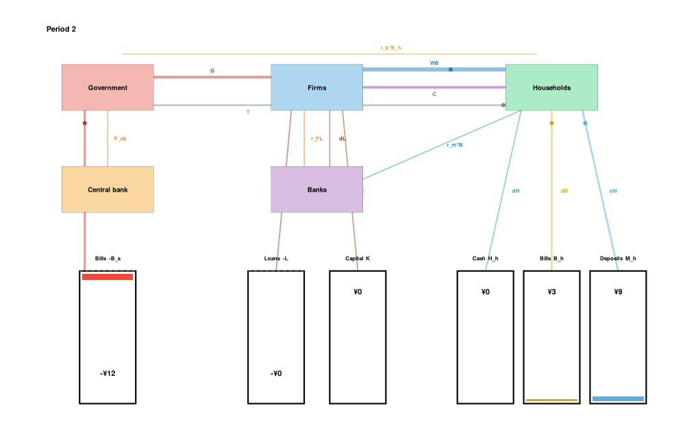
</figure>

To inspect the plumbing of a single period, we can freeze one snapshot and lay its payments out side by side. The Sankey diagram of Figure 3 shows the transactions-flow matrix of period 20, when the economy is still growing towards its steady state: payers are on the left, transactions in the middle and payees on the right. Since every transaction has exactly one source and one destination, each sector's outflows and inflows balance. The lower part of the diagram shows how saving is channelled: households add to their cash, bills and deposits, banks lend to firms and buy bills, and the government covers its deficit by issuing bills to households, banks and the central bank.

#### Figure 3. Transactions-flow matrix of Model SBM in period 20 (Sankey diagram)

<figure>
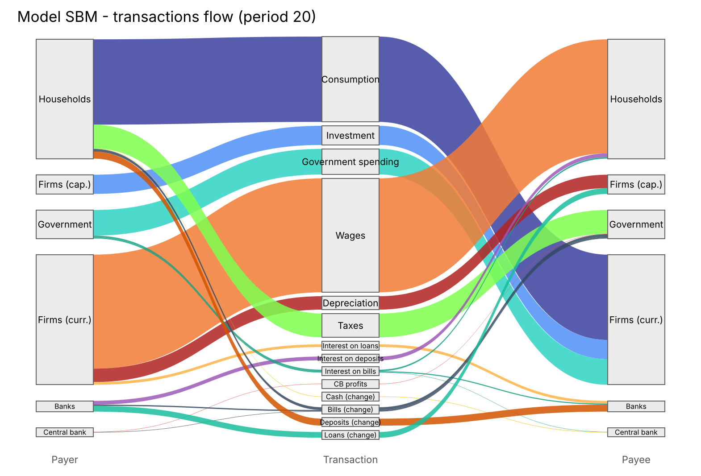
</figure>

Simulated over time, these flows generate the dynamic paths shown in Figure 4. National income converges monotonically to its steady state of about ¥132, and gross investment settles at about 15% of GDP. The consistency check (panel a) is zero throughout. Panel d) shows the accounting identity $V = B_s + K$ at work: household wealth (about ¥368) is matched by public debt (about ¥171) plus fixed capital (about ¥198).

#### Figure 4. Baseline dynamics of Model SBM

<figure>
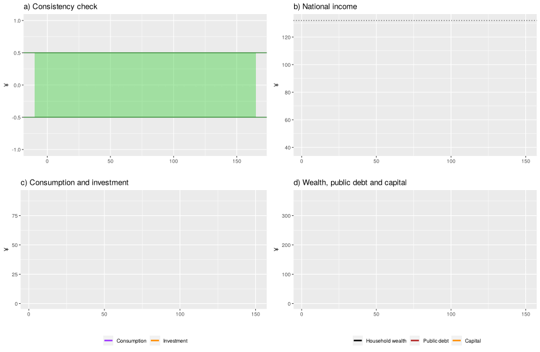
</figure>

**An experiment: higher government spending.** In the second scenario of the code, government spending rises permanently from ¥20 to ¥25 at period 101. In Figure 5, the grey line is the baseline and the red one is the shock scenario. The fiscal expansion raises income and consumption through the usual multiplier, and investment follows as firms adjust their capital stock. The government budget moves into deficit (by about ¥3 on impact), but the deficit closes gradually, because higher income generates higher tax revenue. National income settles at about ¥165, consistent with the steady-state formula above, while public debt stabilises at a higher level (from about ¥171 to about ¥213). However, the ratio of public debt to GDP does not rise: it first falls, from 1.29 to about 1.22, because income jumps at once while debt builds up slowly, and then returns to 1.29 in the long run. Apart from government spending, the model has no autonomous terms (the fiscal rule is inactive at the reference interest rate), so that in the stationary state all stocks and flows are proportional to $G$. The debt-to-GDP ratio depends on the tax rate, the propensities to consume, the portfolio coefficients and the interest rate, not on the level of public spending.

#### Figure 5. Model SBM: higher government spending

<figure>
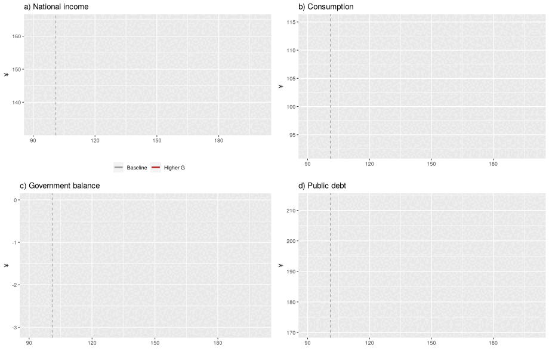
</figure>

#### 🛠️ Hands-on: the structure of the code

All the scripts in this repository share the same structure, so it is worth describing it once. The [`1a_SBM.R`](1a_SBM.R) script is organised in five blocks:

1. **Parameters**: the number of periods and scenarios, the date of the shock, and the values of all the coefficients;
1. **Variables**: each endogenous variable is a matrix with one row per scenario and one column per period, initialised at zero; exogenous variables (government spending, interest rates) are matrices too, so that they can be shocked in one scenario only;
1. **Loops**: a loop over scenarios (`j`), a loop over periods (`i`), and an inner loop (`iter`) that solves the simultaneous equations of each period by iteration (see Box A);
1. **Display**: the hidden equation is checked and the key results are printed in the console;
1. **Plots**: six charts summarise the results of the baseline and shock scenarios.

The core of the model is the block of equations inside the inner loop:

```r
    # Solve the SIMULTANEOUS equations by iteration
    for (iter in 1:100) {

      # A) HOUSEHOLDS ####
      YD[j, i]   = WB[j, i] - TAX[j, i] +
        rb[j, i - 1] * B_h[j, i - 1] + rm[j, i - 1] * M_h[j, i - 1] + FB[j, i]  # Disposable income (1)
      TAX[j, i]  = theta * (WB[j, i] + FB[j, i] + rb[j, i - 1] * B_h[j, i - 1] +
        rm[j, i - 1] * M_h[j, i - 1])                                        # Taxes on household income (2)
      V[j, i]    = V[j, i - 1] + (YD[j, i] - C[j, i])                       # Wealth accumulation (3)
      alpha1[j, i] = alpha10 - alpha11 * rb[j, i - 1]               # Propensity to consume and interest rate (4)
      C[j, i]    = alpha1[j, i] * YD[j, i] + alpha2 * V[j, i - 1]           # Consumption (5)
      H_h[j, i]  = lambdac * C[j, i - 1]                                    # Cash for transactions (6)
      B_h[j, i]  = V[j, i] * (lambda10 + lambda11 * rb[j, i])               # Demand for bills (7)
      M_h[j, i]  = V[j, i] - H_h[j, i] - B_h[j, i]                          # Deposits as buffer stock (8)

      # B) FIRMS ####
      Y[j, i]    = C[j, i] + I[j, i] + G[j, i]                              # GDP (9)
      WB[j, i]   = Y[j, i] - rl[j, i - 1] * L_d[j, i - 1] - AF[j, i]        # Wage bill = residual, no retained profits (10)
      N[j, i]    = Y[j, i] / pr                                             # Employment (11)
      w[j, i]    = WB[j, i] / N[j, i]                                       # Wage rate (12)
      KT[j, i]   = kappa * Y[j, i - 1]                                      # Target capital (13)
      DA[j, i]   = delta * K[j, i - 1]                                      # Depreciation allowances (14)
      AF[j, i]   = DA[j, i]                                                 # Amortisation funds (15)
      I[j, i]    = gamma * (KT[j, i] - K[j, i - 1]) + DA[j, i]              # Gross investment (16)
      K[j, i]    = K[j, i - 1] + I[j, i] - DA[j, i]                         # Capital accumulation (17)
      L_d[j, i]  = L_d[j, i - 1] + I[j, i] - AF[j, i]                       # Loans fund net investment (18)  

      # C) BANKS ####
      L_s[j, i]  = L_s[j, i - 1] + (L_d[j, i] - L_d[j, i - 1])              # Loans supplied on demand (19)
      M_s[j, i]  = M_s[j, i - 1] + (L_s[j, i] - L_s[j, i - 1])              # Loans create deposits (20)
      B_b[j, i]  = M_h[j, i] - M_s[j, i]                                    # Bills held by banks (21)
      FB[j, i]   = rl[j, i - 1] * L_s[j, i - 1] + rb[j, i - 1] * B_b[j, i - 1] -
        rm[j, i - 1] * M_h[j, i - 1]                                         # Bank profits (22)

      # D) GOVERNMENT AND CENTRAL BANK ####
      F_cb[j, i] = rb[j, i - 1] * B_cb[j, i - 1]                            # Central bank profits (23)
      G[j, i]    = G0[j, i] - psi * (rb[j, i - 1] - rbar) * B_s[j, i - 1]   # Fiscal rule (24)
      PSBR[j, i] = G[j, i] + rb[j, i - 1] * B_s[j, i - 1] - TAX[j, i] - F_cb[j, i] # Borrowing requirement (25)
      B_s[j, i]  = B_s[j, i - 1] + PSBR[j, i]                               # Supply of bills (26)
      B_cb[j, i] = B_s[j, i] - B_h[j, i] - B_b[j, i]                        # Central bank residual (27)
      H_s[j, i]  = H_s[j, i - 1] + (B_cb[j, i] - B_cb[j, i - 1])            # Supply of cash (28)
    }
```

Notice that the order of the equations does not matter for the solution: since the block is repeated 100 times in each period, every variable eventually takes the value consistent with all the others (Box A explains how this works). Lagged values (`i - 1`) come from the previous period and are therefore already known.

> ### 📦 Box A - How the models are solved
>
> Within each period, the equations of an SFC model form a system of simultaneous equations: consumption depends on disposable income, which depends on wages, which depend on output, which depends on consumption. The scripts of this repository solve the system with the simplest possible method, a **fixed-point iteration** of the Gauss-Seidel type. The variables of the current period start from zero, the value at which all the matrices are initialised. Then the whole block of equations is computed, from top to bottom, and each equation uses the most recent values of the variables on its right-hand side, whether they have been computed in the current iteration or in the previous one. After a sufficient number of iterations, the values stop changing: all the equations then hold at the same time, and the solution has been found. The method is convergent when the feedback loops within the period are dampened, which is the case in our models, since the propensities to consume (and, in the open models, the import propensity) are smaller than one.
>
> The scripts repeat the block a fixed number of times (`for (iter in 1:100)`). This is simple and transparent, but not efficient: most of the iterations are wasted once the solution has been found, while, in models with strong feedbacks, 100 iterations may not be enough. Two simple improvements are commonly used:
>
> 1. **A convergence tolerance.** At the end of each iteration, the values of a few key variables are compared with those of the previous iteration, and the loop stops when the largest difference falls below a small tolerance, for instance $10^{-12}$.
> 1. **A maximum number of iterations.** The loop is stopped anyway after a maximum number of iterations, so that the program does not run forever if the solution is not found. If this happens, the model should be checked: the hidden equation will usually reveal the problem.
>
> Both are used in `2d_IO_OPENSBM_SRAFFA.R`, where the solution of each period requires about 50 iterations:
>
> ```r
>     for (iter in 1:maxIter) {                                         # maxIter <- 1000
>       check0 <- c(Y[j, i], V[j, i], p_c[j, i], xr[j, i])                # values at the previous iteration
>       ...                                                             # block of equations
>       if (max(abs(c(Y[j, i], V[j, i], p_c[j, i], xr[j, i]) - check0)) < tol) break   # tol <- 1e-12
>     }
> ```
>
> Dedicated packages use more sophisticated methods. For instance, the `R` package [`sfcr`](https://joaomacalos.github.io/sfcr/reference/sfcr_baseline.html) lets the user choose between the Gauss-Seidel, Newton-Raphson and Broyden algorithms, with a maximum number of iterations and a tolerance as arguments. For small models like ours, however, the simple iteration is more than adequate, and it has the advantage of keeping every equation visible in the code.

> ### 📦 Box B - Playing with Model SBM
>
> The simulation laboratory below allows you to change the main coefficients and policy variables of Model SBM, from period 101 onwards, and to see the effects immediately. It is a self-contained HTML/JavaScript version of `1a_SBM.R`, with the same equations and parameters. Similar laboratories are available for Model OPENSBM-FLEX (Section 2.2), Model IO-SBM with fixed prices (Section 3.2) and Model ECO-IO-SBM (Section 4.2). Each laboratory can also be opened offline, by downloading the corresponding `.html` file from the folder `beijing_figures` and opening it in a browser.
>
> [](https://marcoverpas.github.io/Beijing_lectures_2026/beijing_figures/int_sbm.html)
> <div align="center">
> <figure>
> <a href="https://marcoverpas.github.io/Beijing_lectures_2026/beijing_figures/int_sbm.html" target="_blank">
> 
> </a>
> </figure>
> </div>

> ### ✏️ Box C - Exercises with Model SBM
>
> 1. **Monetary policy.** Raise the interest rate from 2% to 3% in the second scenario, instead of government spending. In the code, this means setting `rb[j, i]`, `rm[j, i]` and `rl[j, i]` equal to 0.03 when `i >= shockStart && j == 2`, and leaving `G0` unchanged. What happens to national income in the short run and in the long run? Why? Repeat the experiment with `psi <- 0`, so that the government does not react to its higher interest bill: what changes, and why? Finally, set `alpha11 <- 0` (and `alpha10 <- 0.6`). (Hint: who receives the interest paid by the government, and what happens to public debt in the long run?)
> 1. **The paradox of thrift.** Lower the autonomous propensity to consume out of income, `alpha10`, in the second scenario. Compare the short-run and the long-run effects on national income, and explain them using the steady-state formula above.
> 1. **The portfolio of households.** Raise `lambda10`. How does the composition of household wealth change? What happens to the bills held by banks and to the cash issued by the central bank?
> 1. **Breaking an identity.** The safest way to see what happens when a model is not stock-flow consistent is to change one of its identities. In equation (25), drop the central bank profits, `F_cb[j, i]`, from the borrowing requirement of the government, as if the profits paid by the central bank were never received. Run the model again and look at panel a): what happens to the consistency check $H_h - H_s$, and why?
>
> 👉 **Answers:** [here](ANSWERS.md#box-c---model-sbm).

### 2.2 - The open economy: Model OPENSBM-FLEX

📄 **R code:** [`1c_OPENSBM_FLEX.R`](1c_OPENSBM_FLEX.R) (flexible exchange rate) · [`1b_OPENSBM_FIX.R`](1b_OPENSBM_FIX.R) (fixed exchange rate, Box D)

Model **OPENSBM-FLEX** opens Model SBM to the rest of the world. Following [Zezza (2026)](#references), the rest of the world is a single aggregate sector, whose income and interest rate are given. The domestic economy exports goods to it and imports goods from it. Domestic households can hold foreign bills, while foreign investors hold domestic government bills. The exchange rate floats: the domestic currency depreciates when the economy runs a current account deficit, and appreciates when it runs a surplus.

The key additional assumptions are:

1. Small open economy: foreign income ($Y_w$) and the foreign interest rate ($r_w$) are exogenous
1. A sixth sector, the rest of the world, which trades goods with the domestic economy and holds domestic bills
1. One more financial asset: foreign bills, denominated in foreign currency and held by domestic households
1. Exports and imports depend on the exchange rate and on foreign and domestic income, respectively
1. A flexible exchange rate, defined as the domestic price of one unit of foreign currency, which adjusts gradually to the current account
1. Fixed prices in both economies, so that the nominal exchange rate is also the real exchange rate

The associated accounting matrices are shown in Tables 7 and 8.

#### Table 7. Balance-sheet matrix of Model OPENSBM-FLEX

|                     | Households          | Firms     | Banks     | Central bank | Government | Rest of the world      | Row tot. |
|:--------------------|:-------------------:|:---------:|:---------:|:------------:|:----------:|:----------------------:|:--------:|
| Cash                | $+H_h$              |           |           | $-H_s$       |            |                        | 0        |
| Deposits            | $+M_h$              |           | $-M_h$    |              |            |                        | 0        |
| Loans               |                     | $-L_d$    | $+L_s$    |              |            |                        | 0        |
| Domestic bills      | $+B_h$              |           | $+B_b$    | $+B_{cb}$    | $-B_s$     | $+B_w$                 | 0        |
| Foreign bills       | $+xr \cdot BF_h$    |           |           |              |            | $-xr \cdot BF_h$       | 0        |
| Fixed capital       |                     | $+K$      |           |              |            |                        | $+K$     |
| Net worth           | $-V$                | 0         | 0         | 0            | $+B_s$     | $+NETFA$               | $-K$     |
| **Column tot.**     | 0                   | 0         | 0         | 0            | 0          | 0                      | 0        |

Compared with Table 5, there is one more asset (foreign bills, converted into domestic currency at the current exchange rate $xr$) and one more sector. The net worth of the rest of the world vis-à-vis the domestic economy is the opposite of the **net foreign assets** of the domestic economy, $NETFA = xr \cdot BF_h - B_w$. The identity of Section 2.1 now becomes $V = B_s + K + NETFA$: household wealth is matched by public debt, fixed capital and claims on the rest of the world.

#### Table 8. Transactions-flow matrix of Model OPENSBM-FLEX

|                            | Households                                  | Firms (current)            | Firms (capital) | Banks                            | Central bank                 | Government                   | Rest of the world                           | Row tot. |
|:---------------------------|:-------------------------------------------:|:--------------------------:|:---------------:|:--------------------------------:|:----------------------------:|:----------------------------:|:-------------------------------------------:|:--------:|
| Consumption                | $-C$                                        | $+C$                       |                 |                                  |                              |                              |                                             | 0        |
| Investment                 |                                             | $+I$                       | $-I$            |                                  |                              |                              |                                             | 0        |
| Government spending        |                                             | $+G$                       |                 |                                  |                              | $-G$                         |                                             | 0        |
| Exports                    |                                             | $+X$                       |                 |                                  |                              |                              | $-X$                                        | 0        |
| Imports                    |                                             | $-IM$                      |                 |                                  |                              |                              | $+IM$                                       | 0        |
| [Production]               |                                             | [$Y$]                      |                 |                                  |                              |                              |                                             |          |
| Wages                      | $+WB$                                       | $-WB$                      |                 |                                  |                              |                              |                                             | 0        |
| Depreciation               |                                             | $-AF$                      | $+AF$           |                                  |                              |                              |                                             | 0        |
| Taxes                      | $-T$                                        |                            |                 |                                  |                              | $+T$                         |                                             | 0        |
| Interest on loans          |                                             | $-r_{l,-1} \cdot L_{d,-1}$ |                 | $+r_{l,-1} \cdot L_{s,-1}$       |                              |                              |                                             | 0        |
| Interest on deposits       | $+r_{m,-1} \cdot M_{h,-1}$                  |                            |                 | $-r_{m,-1} \cdot M_{h,-1}$       |                              |                              |                                             | 0        |
| Interest on domestic bills | $+r_{b,-1} \cdot B_{h,-1}$                  |                            |                 | $+r_{b,-1} \cdot B_{b,-1}$       | $+r_{b,-1} \cdot B_{cb,-1}$  | $-r_{b,-1} \cdot B_{s,-1}$   | $+r_{b,-1} \cdot B_{w,-1}$                  | 0        |
| Interest on foreign bills  | $+xr \cdot r_{w,-1} \cdot BF_{h,-1}$        |                            |                 |                                  |                              |                              | $-xr \cdot r_{w,-1} \cdot BF_{h,-1}$        | 0        |
| Bank profits               | $+F_b$                                      |                            |                 | $-F_b$                           |                              |                              |                                             | 0        |
| Central bank profits       |                                             |                            |                 |                                  | $-F_{cb}$                    | $+F_{cb}$                    |                                             | 0        |
| Change in cash             | $-\Delta H_h$                               |                            |                 |                                  | $+\Delta H_s$                |                              |                                             | 0        |
| Change in deposits         | $-\Delta M_h$                               |                            |                 | $+\Delta M_h$                    |                              |                              |                                             | 0        |
| Change in loans            |                                             |                            | $+\Delta L_d$   | $-\Delta L_s$                    |                              |                              |                                             | 0        |
| Change in domestic bills   | $-\Delta B_h$                               |                            |                 | $-\Delta B_b$                    | $-\Delta B_{cb}$             | $+\Delta B_s$                | $-\Delta B_w$                               | 0        |
| Change in foreign bills    | $-xr \cdot \Delta BF_h$                     |                            |                 |                                  |                              |                              | $+xr \cdot \Delta BF_h$                     | 0        |
| **Column tot.**            | 0                                           | 0                          | 0               | 0                                | 0                            | 0                            | 0                                           | 0        |

The column of the rest of the world in Table 8 shows that the current account of the domestic economy, $CA = X - IM + xr \cdot r_{w,-1} \cdot BF_{h,-1} - r_{b,-1} \cdot B_{w,-1}$, must be matched by a change in its net claims on the rest of the world, $xr \cdot \Delta BF_h - \Delta B_w$. Notice that there is no row for **capital gains**. When the domestic currency depreciates, the value of the foreign bills held by households rises, but no transaction takes place. Capital gains change the stocks of Table 7 without appearing in Table 8, and they must be added to saving when we compute the change in household wealth.

**Equations.** Model OPENSBM-FLEX has 37 equations (the numbers match those of the script of the model, `1c_OPENSBM_FLEX.R`). The equations of firms, banks and the government are those of Model SBM; below we only report the equations that change or are added. For households:

$$YD = WB + F_b - T + r_{b,-1} \cdot B_{h,-1} + r_{m,-1} \cdot M_{h,-1} + xr \cdot r_{w,-1} \cdot BF_{h,-1} \quad \text{(1) [I]}$$

$$CG = \Delta xr \cdot BF_{h,-1} \quad \text{(2) [I]}$$

$$T = \theta \cdot (WB + F_b + r_{b,-1} \cdot B_{h,-1} + r_{m,-1} \cdot M_{h,-1} + xr \cdot r_{w,-1} \cdot BF_{h,-1}) \quad \text{(3) [B]}$$

$$V = V_{-1} + YD - C + CG \quad \text{(4) [I]}$$

$$B_h = V \cdot (\lambda_{10} + \lambda_{11} \cdot r_b - \lambda_{12} \cdot r_w) \quad \text{(8) [B]}$$

$$BF_h = \frac{V}{xr} \cdot (\lambda_{20} - \lambda_{21} \cdot r_b + \lambda_{22} \cdot r_w) \quad \text{(9) [B]}$$

$$M_h = V - H_h - B_h - xr \cdot BF_h \quad \text{(10) [I]}$$

Disposable income now includes the interest earned on foreign bills, converted into domestic currency (1), which is also taxed (3). Capital gains on foreign bills (2) are not part of disposable income, but they are added to saving to obtain the change in household wealth (4). Consumption still depends on disposable income, so that a depreciation raises household wealth without directly raising consumption. Households now choose between domestic and foreign bills on the basis of the two interest rates, following [Tobin's (1982)](#references) portfolio approach (8)-(9), while deposits remain the buffer stock (10). Firms sell to foreign buyers and domestic demand partly leaks abroad:

$$Y = C + I + G + X - IM \quad \text{(11) [E]}$$

Since domestic bills are now also held by the rest of the world, the central bank buys what is left after households, banks *and* foreign investors have satisfied their demand:

$$B_{cb} = B_s - B_h - B_b - B_w \quad \text{(29) [E]}$$

The rest of the world is described by seven equations:

$$\ln X = \varepsilon_0 + \varepsilon_1 \cdot \ln xr_{-1} + \varepsilon_2 \cdot \ln Y_w \quad \text{(31) [B]}$$

$$\ln IM = \iota_0 - \iota_1 \cdot \ln xr_{-1} + \iota_2 \cdot \ln Y \quad \text{(32) [B]}$$

$$TB = X - IM \quad \text{(33) [I]}$$

$$CA = TB + xr \cdot r_{w,-1} \cdot BF_{h,-1} - r_{b,-1} \cdot B_{w,-1} \quad \text{(34) [I]}$$

$$NETFA = NETFA_{-1} + CA + CG \quad \text{(35) [I]}$$

$$B_w = xr \cdot BF_h - NETFA \quad \text{(36) [I]}$$

$$xr = xr_{-1} \cdot \exp \left( -\phi_{xr} \cdot \frac{CA}{Y} \right) \quad \text{(37) [B]}$$

Exports depend on foreign income and imports on domestic income, with unit elasticities ($\varepsilon_2 = \iota_2 = 1$). A depreciation of the domestic currency (a rise in $xr$) makes domestic goods cheaper for foreign buyers and foreign goods dearer for domestic buyers, with a lag of one period (31)-(32). The trade balance (33) plus net interest income from abroad gives the current account (34). Net foreign assets change with the current account and with capital gains (35). The rest of the world is modelled in the simplest possible way: it has no behavioural equations of its own, and its holdings of domestic bills are a residual, which ensures that the foreign financial position of the economy is consistent with its current account (36). Finally, the exchange rate depreciates when the current account is in deficit and appreciates when it is in surplus (37); the coefficient $\phi_{xr} = 3$ sets the speed of adjustment, and the exponential form ensures that $xr$ remains positive. With $\varepsilon_0 = \ln 0.1$, $\iota_0 = \ln 0.2$ and $Y_w = 200$, exports would be ¥20 and imports one-fifth of GDP at $xr = 1$. Unless otherwise stated, the other coefficients are those of Model SBM, while the portfolio coefficients are $\lambda_{10} = 0.15$, $\lambda_{20} = 0.1$ and $\lambda_{11} = \lambda_{12} = \lambda_{21} = \lambda_{22} = 1$.

**The hidden equation and the steady state.** The redundant equation is still $H_h = H_s$, which is checked in the code as in Model SBM. In the stationary state, two conditions must now hold at the same time: the government budget must be balanced ($PSBR = 0$), and the current account must be balanced ($CA = 0$), otherwise net foreign assets would keep changing. With a flexible exchange rate, both conditions can be met: the fiscal anchor still pins down national income, while the exchange rate adjusts until the trade balance offsets net interest payments from abroad. With the baseline parameters, national income converges to about ¥132, almost exactly as in Model SBM, and the domestic currency depreciates by about 19% ($xr \approx 1.19$). This is because, at $xr = 1$, imports (about ¥26) would exceed exports (¥20).

**An experiment: higher government spending.** As in Section 2.1, government spending rises from ¥20 to ¥25 at period 101. Figure 6 shows the results. On impact, the multiplier is smaller than in the closed economy (GDP rises by about ¥11 rather than ¥13 after one period), because part of the additional demand leaks abroad through imports. The current account moves into deficit and net foreign assets turn negative, as foreign investors buy domestic bills. The deficit triggers a depreciation of the domestic currency, which makes exports more competitive and curbs imports. The current account is gradually brought back into balance, and the exchange rate settles at about 1.37, 15% above its baseline level. In the new steady state, national income is about ¥165, as in the closed economy: in the long run, the fiscal anchor prevails, and the exchange rate takes care of the external constraint. Public debt rises from about ¥170 to about ¥215, of which about ¥47 is held by the rest of the world.

#### Figure 6. Model OPENSBM-FLEX: higher government spending

<figure>
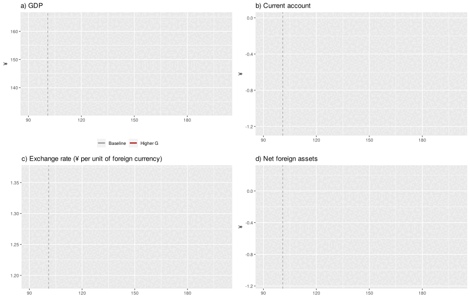
</figure>
<br>

**🎮 Interactive version.** A simulation laboratory for Model OPENSBM-FLEX is available [here](https://marcoverpas.github.io/Beijing_lectures_2026/beijing_figures/int_opensbm.html). It allows you to change fiscal policy, the domestic and foreign interest rates, foreign income, the portfolio share of foreign bills, the price elasticity of trade and the speed of adjustment of the exchange rate. (With a high speed of adjustment and high elasticities, the exchange rate can overshoot and the model can break down, as in exercise 4 of Box E.) As in Box B, new values apply from period 101 onwards, and the baseline is shown for comparison.

[](https://marcoverpas.github.io/Beijing_lectures_2026/beijing_figures/int_opensbm.html)
<div align="center">
<figure>
<a href="https://marcoverpas.github.io/Beijing_lectures_2026/beijing_figures/int_opensbm.html" target="_blank">

</a>
</figure>
</div>

#### 🛠️ Hands-on: what changes in the code

The structure of `1c_OPENSBM_FLEX.R` is the same as that of `1a_SBM.R`. The new parameters are the coefficients of the export and import equations (`eps0`-`eps2`, `mu0`-`mu2`), the portfolio coefficients of foreign bills (`lambda20`-`lambda22`) and the speed of adjustment of the exchange rate (`phixr`). The foreign interest rate (`rw`) and foreign income (`yw`) are exogenous matrices, which can be shocked in one scenario only, exactly like government spending. The exchange rate (`xr`) is also defined as a matrix, but it is overwritten by equation (37) in every period. The new block of equations is:

```r
      # E) REST OF THE WORLD ####
      X[j, i]    = exp(eps0 + eps1 * log(xr[j, i - 1]) + eps2 * log(yw[j, i]))  # Exports (31)
      IM[j, i]   = exp(mu0 - mu1 * log(xr[j, i - 1]) + mu2 * log(Y[j, i]))      # Imports (32)
      TB[j, i]   = X[j, i] - IM[j, i]                                       # Trade balance (33)
      CA[j, i]   = TB[j, i] + rw[j, i - 1] * BF_h[j, i - 1] * xr[j, i] -
        rb[j, i - 1] * B_w[j, i - 1]                                         # Current account (34)
      NETFA[j, i]= NETFA[j, i - 1] + CA[j, i] + CG[j, i]                    # Net foreign assets (35)
      B_w[j, i]  = BF_h[j, i] * xr[j, i] - NETFA[j, i]                      # Domestic bills held by RoW (36)
      xr[j, i]   = xr[j, i - 1] * exp(-phixr * CA[j, i] / max(Y[j, i], 1))  # Flexible exchange rate (37)
```

Notice that the exchange rate enters the export and import equations with a lag, while it is determined simultaneously with the current account in equation (37). This is a typical choice in SFC models: trade flows take time to respond to relative prices.

> ### 📦 Box D - What if the exchange rate is fixed?
>
> The file `1b_OPENSBM_FIX.R` contains a version of the model in which the central bank pegs the exchange rate. Equation (37) is dropped, so that the model has 36 equations, and capital gains are always zero. All the coefficients are those of Model OPENSBM-FLEX. With a fixed exchange rate, the baseline reaches a stationary state only for one specific value of the peg, which is calibrated in the code ($\bar{xr} \approx 1.06$). In the early periods, when national income is still low, exports exceed imports and the economy accumulates claims on the rest of the world. In the stationary state, net foreign assets are about ¥94, and the interest earned on them exactly offsets a trade deficit of about ¥1.9. Since these claims exceed the foreign bills held by households, the holdings of domestic bills by the rest of the world are negative (about −¥61): this can be read as foreign reserves accumulated by the central bank to defend the peg.
>
> Run the government-spending experiment with this version. Figure 7 compares the current account and net foreign assets under the two regimes. With a fixed exchange rate, the economy cannot reach a new stationary state: the fiscal anchor requires $PSBR = 0$, while external stability requires $CA = 0$, and there is only one variable (national income) that can adjust. Higher spending generates a permanent trade deficit, which is financed by selling domestic bills to the rest of the world. The interest payments on the growing foreign debt widen the current account deficit, which in turn raises the debt: the **twin deficits** feed each other and diverge. Under a flexible exchange rate, instead, net foreign assets remain close to zero (about ¥0.25 in the baseline and −¥1.2 after the shock, too small to be seen in Figure 7). Any current account imbalance moves the exchange rate in the direction that removes it, so that the deficit is small and short-lived, and the foreign bills held by households are almost exactly matched by the domestic bills held by the rest of the world.
>
> #### Figure 7. Current account and net foreign assets under fixed and flexible exchange rates
>
> <figure>
> 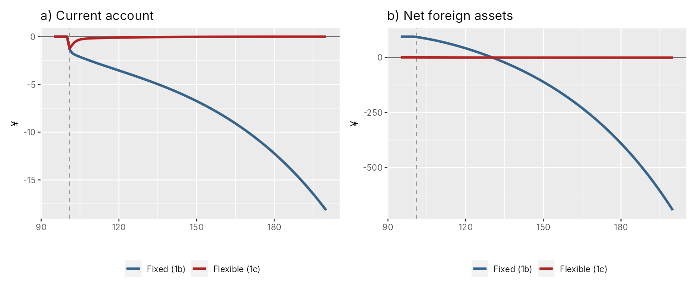
> </figure>

> ### ✏️ Box E - Exercises with Models OPENSBM-FLEX and OPENSBM-FIX
>
> 1. **A foreign boom.** Raise foreign income `yw` from 200 to 220 in the second scenario, instead of government spending. What happens to exports, national income and the exchange rate in the short run and in the long run? Compare the long-run effect on national income with that of the fiscal expansion, and explain the difference using the fiscal anchor.
> 1. **Foreign monetary policy.** Raise the foreign interest rate `rw` from 2% to 3%. How do households change the composition of their wealth? What happens to the current account and the exchange rate? (Hint: look at both the portfolio equations and the interest flows in the current account.)
> 1. **Domestic monetary policy.** Repeat exercise 1 of Box C with Model OPENSBM-FLEX, raising `rb`, `rm` and `rl` together. Is the short-run fall in national income larger or smaller than in the closed economy? What happens to the exchange rate, and why?
> 1. **The speed of adjustment.** Set `phixr` equal to 1 and then to 5. How do the paths of the exchange rate and the current account change? Is the long-run outcome affected? Now try `phixr <- 10`: what happens, and why?
> 1. **The twin deficits.** Run the government-spending experiment with `1b_OPENSBM_FIX.R` (Box D). Why does national income stop growing at about ¥134, while foreign debt keeps rising?
> 1. **Policy under a peg.** Which policy rules (for instance, for government spending, taxes or the interest rate) could restore a stationary state under a fixed exchange rate?
> 1. **Foreign reserves.** In `1b_OPENSBM_FIX.R`, foreign reserves are only implicit. How would you modify the balance-sheet and transactions-flow matrices to record them explicitly in the column of the central bank?
>
> 👉 **Answers:** [here](ANSWERS.md#box-e---models-opensbm-flex-and-opensbm-fix).

---

## 3 - Input-output models

This section opens the "black box" of production. The single good of Model SBM is replaced by three goods, produced by three industries (agriculture, manufacturing and services) that buy inputs from one another. The macroeconomic structure of Model SBM is left unchanged: the input-output (IO) core is added as a new block of equations. Section 3.1 introduces IO analysis and explains why it is worth combining with SFC modelling. Section 3.2 presents Model IO-SBM with fixed prices, and Section 3.3 shows how the price system can be closed in an alternative way, with Sraffa-like prices. Section 3.4 extends both closures to the open economy.

### 3.1 - IO models and why to combine them with SFC models

The models of Section 2 are **fully aggregated**: production is a single homogeneous good, made by a single representative firm. **Input-output analysis**, pioneered by [Leontief (1936)](#references), splits production into several **industries**, which buy and sell intermediate goods from one another ([Miller and Blair, 2009](#references)). Each industry needs the products of the others as inputs, so that gross output must cover both **intermediate demand** and **final demand** (consumption, investment and government spending).

Consider an economy with three industries, labelled $1$ (agriculture), $2$ (manufacturing) and $3$ (services). Each label stands for an aggregate of the many industries of official classifications: for instance, "services" includes trade, transport, accommodation, information and communication, finance, real estate, public administration, education and health, which together make up the tertiary sector of national statistics. We assume that each industry produces a single product with a single technique of production (one industry, one product, one technique). Let $x_i$ be the gross output of industry $i$, $d_i$ the final demand for its product, and $a_{ij}$ the **technical coefficient**, that is, the amount of good $i$ needed to produce one unit of good $j$ (Box F explains how technical coefficients are obtained from an input-output table). The gross output of each industry must cover the inputs required by all the industries, plus final demand:

$$x_1 = a_{11} \cdot x_1 + a_{12} \cdot x_2 + a_{13} \cdot x_3 + d_1$$

$$x_2 = a_{21} \cdot x_1 + a_{22} \cdot x_2 + a_{23} \cdot x_3 + d_2$$

$$x_3 = a_{31} \cdot x_1 + a_{32} \cdot x_2 + a_{33} \cdot x_3 + d_3$$

The nine technical coefficients can be collected in a single **matrix of technical coefficients** $\mathbf{A}$, with the inputs in rows and the goods produced in columns. In Model IO-SBM (Section 3.2), it is:

$$\mathbf{A} = \begin{bmatrix} a_{11} & a_{12} & a_{13} \cr a_{21} & a_{22} & a_{23} \cr a_{31} & a_{32} & a_{33} \end{bmatrix} = \begin{bmatrix} 0.11 & 0.12 & 0.10 \cr 0.21 & 0.22 & 0.20 \cr 0.15 & 0.18 & 0.10 \end{bmatrix}$$

Each **column** is the "recipe" of a good: the first one says that producing one unit of agricultural goods requires $0.11$ units of agricultural goods, $0.21$ units of manufactured goods and $0.15$ units of services. Each **row**, read horizontally, shows how much of a given good is absorbed as an input by the various industries. Gross outputs and final demands form two **column** vectors:

$$\mathbf{x} = \begin{bmatrix} x_1 \cr x_2 \cr x_3 \end{bmatrix}, \qquad \mathbf{d} = \begin{bmatrix} d_1 \cr d_2 \cr d_3 \end{bmatrix}$$

so that the three equations above can be written in **extended form** as:

$$\begin{bmatrix} x_1 \cr x_2 \cr x_3 \end{bmatrix} = \begin{bmatrix} a_{11} & a_{12} & a_{13} \cr a_{21} & a_{22} & a_{23} \cr a_{31} & a_{32} & a_{33} \end{bmatrix} \begin{bmatrix} x_1 \cr x_2 \cr x_3 \end{bmatrix} + \begin{bmatrix} d_1 \cr d_2 \cr d_3 \end{bmatrix}$$

The $i$-th row of this system, $x_i = \sum_{j} a_{ij} \cdot x_j + d_i$, says that the output of industry $i$ is equal to the intermediate demand for good $i$ coming from all the industries, $\sum_{j} a_{ij} \cdot x_j$, plus the final demand for it. With $n$ industries, everything generalises: $\mathbf{A}$ becomes an $n \times n$ matrix, and $\mathbf{x}$ and $\mathbf{d}$ have $n$ elements. Collecting all the terms, we obtain the **compact form**:

$$\mathbf{x} = \mathbf{A} \cdot \mathbf{x} + \mathbf{d}$$

Since final demand is given, this is a system of $n$ equations in the $n$ unknown gross outputs. Bringing $\mathbf{A} \cdot \mathbf{x}$ to the left-hand side, $(\mathbf{I} - \mathbf{A}) \cdot \mathbf{x} = \mathbf{d}$, where $\mathbf{I}$ is the identity matrix, and solving for $\mathbf{x}$:

$$\mathbf{x} = (\mathbf{I} - \mathbf{A})^{-1} \cdot \mathbf{d}$$

where $(\mathbf{I} - \mathbf{A})^{-1}$ is the **Leontief inverse**. Its element $(i, j)$ measures how much good $i$ must be produced, directly and indirectly, to deliver one unit of good $j$ to final demand. In Model IO-SBM:

$$(\mathbf{I} - \mathbf{A})^{-1} = \begin{bmatrix} 1.209 & 0.229 & 0.185 \cr 0.397 & 1.427 & 0.361 \cr 0.281 & 0.323 & 1.214 \end{bmatrix}$$

The diagonal elements are larger than one, because each industry must produce at least the unit delivered to final demand, plus what is needed to produce it. The sum of the elements of column $j$ is the **output multiplier** of industry $j$: it measures by how much total gross output rises when the final demand for good $j$ rises by one unit. For instance, the output multiplier of agriculture is the sum of the first column, $1.209 + 0.397 + 0.281 \approx 1.89$: one more unit of final demand for agricultural goods raises the gross output of agriculture by 1.209 units, that of manufacturing by 0.397 units and that of services by 0.281 units.

> ### 📦 Box F - What is an input-output table?
>
> An input-output table pictures the economy as a set of **industries** that trade with one another. Each industry produces a single good, and to do so it must buy the goods of the other industries as **intermediate inputs**. Part of every industry's output is therefore absorbed inside the productive system, and only what is left over is delivered to **final demand**. The whole picture is summarised in a single accounting table, shown in Table 9 ([Miller and Blair, 2009, chapters 1-2](#references)).
>
> #### Table 9. Structure of an input-output table
>
> |                     | Industry 1 | Industry 2 | $\cdots$ | Industry $n$ | Final demand | Total output |
> |:--------------------|:----------:|:----------:|:--------:|:------------:|:------------:|:------------:|
> | **Industry 1**      | $z_{11}$   | $z_{12}$   | $\cdots$ | $z_{1n}$     | $d_1$        | $x_1$        |
> | **Industry 2**      | $z_{21}$   | $z_{22}$   | $\cdots$ | $z_{2n}$     | $d_2$        | $x_2$        |
> | $\vdots$            | $\vdots$   | $\vdots$   | $\ddots$ | $\vdots$     | $\vdots$     | $\vdots$     |
> | **Industry $n$**    | $z_{n1}$   | $z_{n2}$   | $\cdots$ | $z_{nn}$     | $d_n$        | $x_n$        |
> | **Value added**     | $VA_1$     | $VA_2$     | $\cdots$ | $VA_n$       |              |              |
> | **Total input**     | $x_1$      | $x_2$      | $\cdots$ | $x_n$        |              |              |
>
> Read **along a row**, the table shows how the output of industry $i$ is distributed: the flows $z_{ij}$ sold as inputs to each industry $j$, plus the final demand $d_i$. Read **down a column**, it shows what industry $j$ must buy in order to produce: the same flows $z_{ij}$, plus the value added $VA_j$ (wages, profits, interest and depreciation). Since the total output of each industry equals its total input, the sum of value added across industries equals the sum of final demands, that is, GDP measured from the income side equals GDP measured from the expenditure side.
>
> The key assumption is that production uses inputs in **fixed proportions**. The technical coefficients are obtained as $a_{ij} = z_{ij} / x_j$, so that intermediate flows can be written as $z_{ij} = a_{ij} \cdot x_j$, which gives the Leontief system above. In practice, the matrix $\mathbf{A}$ is computed from the IO tables published by national statistical offices, or from multi-country databases. It is a **demand-driven** picture: given any vector of final demand, the Leontief inverse returns the gross output that every industry must produce to satisfy it.
>
> A note on "real" variables. In this repository, variables described as "real" (real output, real final demand, and so on) should not be read as physical quantities (tonnes, units, hours). IO tables, like national accounts, record transactions in nominal monetary terms. "Real" variables are nominal values divided by a price index, and "real" technical coefficients computed from deflated data can change over time purely because relative prices change, even when the underlying technique of production is unchanged.

**An example.** Table 10 shows the IO table generated by Model IO-SBM (Section 3.2) in period 100 of the baseline scenario, when prices are all equal to one. The first three columns record the inter-industry flows, the next three columns record the final demand for each good, split between consumption, investment and government spending. The three industries are of different size: manufacturing and services each produce about twice as much as agriculture. The value added of the three industries adds up to about ¥131.8, which is exactly the GDP of the model.

#### Table 10. Input-output table of Model IO-SBM (baseline, period 100, ¥)

|                     | Agriculture | Manufacturing | Services | Consumption | Investment | Government | Total output |
|:--------------------|:-----------:|:-------------:|:--------:|:-----------:|:----------:|:----------:|:------------:|
| **Agriculture**     | 5.1         | 11.9          | 9.9      | 13.8        | 3.9        | 2.0        | 46.7         |
| **Manufacturing**   | 9.8         | 21.9          | 19.8     | 32.3        | 9.8        | 6.0        | 99.6         |
| **Services**        | 7.0         | 17.9          | 9.9      | 46.1        | 5.9        | 12.0       | 98.8         |
| **Value added**     | 24.8        | 47.8          | 59.3     |             |            |            | 131.8        |
| **Total input**     | 46.7        | 99.6          | 98.8     | 92.2        | 19.6       | 20.0       |              |

Figure 8A shows the same table as a **Sankey diagram**: each product, on the left, is split between the three industries that use it as an input and the three components of final demand, on the right, and the width of each band is proportional to the value of the flow. Manufacturing is the main supplier of intermediate inputs (about half of its output, ¥51.5 out of ¥99.6), while services go mostly to final demand (about two thirds of their output).

#### Figure 8A. Uses of products in Model IO-SBM (baseline, period 100, ¥)

<figure>
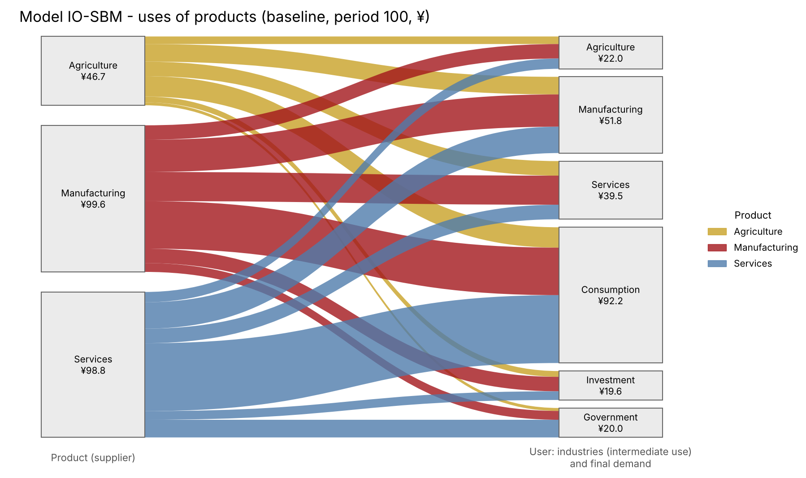
</figure>
<br>

The same information can be represented as a **network**, where industries are the nodes and technical coefficients are the links. In Figure 8B, an arrow from industry $i$ to industry $j$ means that good $i$ is used to produce good $j$; its thickness is proportional to $a_{ij}$, and the size of each node is proportional to gross output. Manufacturing is both the main supplier of inputs to the rest of the system (its row of $\mathbf{A}$ has the largest coefficients) and the most input-intensive industry (its column of $\mathbf{A}$ adds up to 0.52, against 0.47 for agriculture and 0.40 for services). This is why it has the largest output multiplier (about 1.98, against 1.89 for agriculture and 1.76 for services). One more unit of final demand for manufactured goods raises total gross output by almost two units.

#### Figure 8B. Input-output network of Model IO-SBM

<figure>
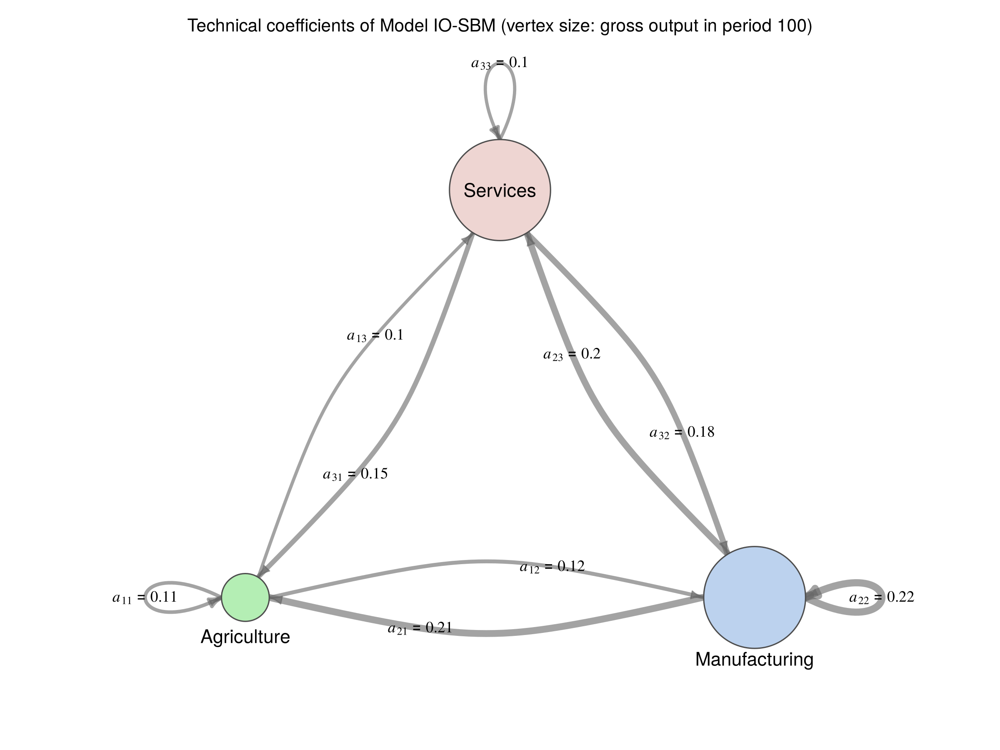
</figure>
<br>

**Why combine IO and SFC models?** Standard IO analysis is powerful, transparent and close to the data, but it is **static**: it compares two snapshots without describing the path between them, and it has little to say about money, debt and financial assets. SFC models are the mirror image: they are dynamic and financially coherent, but they usually work at a high level of aggregation, which hides the inter-industry detail. **IO-SFC models** aim to combine the two approaches: industrial granularity from IO, dynamic and financial coherence from SFC. This makes it possible to analyse questions that neither approach can address on its own, such as how a change in the composition of demand affects employment in each industry, how a fiscal stimulus directed at one industry spreads to the others over time, or how the transition to a low-carbon economy reshapes production, prices and finance at the same time. There are still relatively few IO-SFC models, but the literature is growing quickly, especially in ecological macroeconomics ([Berg et al., 2015](#references); [Veronese Passarella, 2023](#references); [Fevereiro et al., 2025](#references); [Thomsen et al., 2025](#references); [Pettena and Raberto, 2025](#references)). Smaller IO-SFC models, based on Models SIM, PC and BMW, are presented in the [Leeds lectures](https://github.com/marcoverpas/Leeds_lectures_2026#2---input-output-models), the [EAEPE Summer School](https://github.com/marcoverpas/EAEPE_summer_school_2024#3_model_io-pc) and the [Florence keynote speech](https://github.com/marcoverpas/keynote_speech_Florence#22---model-3io-pc). A very simple IO-SFC model, used to bring Minsky's financial instability hypothesis into Graziani's theory of the monetary circuit, is developed in [Veronese Passarella (2025b)](#references).

**How the IO block is plugged into Model SBM.** There is not yet a standard way of combining an IO core with an SFC model, and different authors make different choices. The procedure described below is the one developed by the author of these lectures. It is presented in detail precisely so that SFC modellers can start comparing their methods explicitly. In algebraic terms, adding an IO core to an SFC model requires only a handful of additional equations. Aggregate final demand is first split across industries by **composition shares** (for instance, a given share of consumption is spent on services). In our models, these shares are constant, for simplicity, but they could depend on relative prices or income. The Leontief inverse then turns the vector of final demands into gross outputs, and employment in each industry is obtained by dividing gross output by labour productivity. The financial side of the model is unchanged, since all firms are consolidated in a single sector.

If the macroeconomic block were left exactly as it is, however, the IO core would be a mere *satellite*: it would tell us how output and employment are distributed across industries, but the industrial structure would have no effect on aggregate variables. To avoid this, we make one change to the behaviour of firms. In Model SBM, the target capital stock is proportional to GDP, $K^T = \kappa \cdot Y_{-1}$. In the IO models, each industry has its own **capital intensity**, and the target capital stock depends on the gross output of each industry:

$$K^T = \sum_j \kappa_j \cdot x_{j,-1}$$

with $\kappa_j = 0.8$ in agriculture, $1.3$ in manufacturing and $0.3$ in services. These values are stylised: in real data, some services (real estate in particular) are very capital-intensive. They are calibrated so that the capital-output ratio and the investment share of GDP are the same as in Model SBM in the baseline. The consequence is that the **composition of demand** now matters for investment, and therefore for national income: a shift of demand towards manufactured goods raises the target capital stock and investment, while a shift towards services lowers them. In the long run, national income is still pinned down by the fiscal anchor, so these effects are transitory, but they last for 20 to 40 periods.

What the IO block also requires is a decision about **prices**. With several goods, there are several prices, and we must say how they are determined. Section 3.2 takes the simplest route and keeps all prices fixed and equal to one. Section 3.3 introduces Sraffa-like prices, which reflect unit costs and mark-ups, and which can diverge temporarily from their normal values when demand grows. These are two alternative **closures** of the same model, not two different models.

### 3.2 - Model IO-SBM with fixed prices

📄 **R code:** [`2a_IO_SBM.R`](2a_IO_SBM.R)

Model **IO-SBM** is Model SBM with the three-industry IO core introduced in Section 3.1. In this first closure, all prices are fixed and equal to one, so that nominal and real variables coincide.

The key additional assumptions are:

1. Three industries (agriculture, manufacturing and services), each producing a single good with a fixed technique, described by the matrix $\mathbf{A}$
1. Consumption, investment and government spending are split across industries by fixed composition shares
1. Each industry has its own labour productivity and its own capital intensity
1. A single representative firm sector, which consolidates the three industries
1. Fixed prices, equal to one for all goods

Since the three industries are consolidated in a single firm sector, the balance-sheet and transactions-flow matrices of Model IO-SBM are exactly those of Model SBM (Tables 5 and 6). Purchases of intermediate goods are transactions *within* the firm sector, which cancel out in the consolidated matrices. This is why the IO table (Table 10) is a necessary complement to the SFC matrices: it records the inter-industry flows that the consolidated matrices cannot show.

**Equations.** Model IO-SBM has 31 equations (the numbers match those of the script of the model, `2a_IO_SBM.R`). The equations of households, banks and the government are those of Model SBM. Two equations of firms change. Total employment is now the sum of employment in the three industries, and the target capital stock depends on the gross output of each industry, as explained in Section 3.1:

$$N = \sum_j N_j \quad \text{(11) [I]}$$

$$K^T = \sum_j \kappa_j \cdot x_{j,-1} \quad \text{(13) [B]}$$

The new block describing the **industrial structure** consists of three vector equations:

$$\mathbf{d} = \boldsymbol{\beta}_C \cdot C + \boldsymbol{\beta}_I \cdot I + \boldsymbol{\beta}_G \cdot G \quad \text{(19) [B]}$$

$$\mathbf{x} = (\mathbf{I} - \mathbf{A})^{-1} \cdot \mathbf{d} \quad \text{(20) [E]}$$

$$N_j = \frac{x_j}{pr_j} \quad \text{(21) [B]}$$

Final demand for the product of each industry is a weighted sum of *real* consumption, investment and government spending (19). Since all prices are equal to one, real and nominal values coincide in this closure, but the IO block always works with quantities, and this will matter in Section 3.3. In (19), the vectors $\boldsymbol{\beta}_C$, $\boldsymbol{\beta}_I$ and $\boldsymbol{\beta}_G$ contain the shares of each component spent on agricultural goods, manufactured goods and services. Since the elements of each vector add up to one, the sum of final demands is equal to GDP. Consumption is mostly spent on services ($\boldsymbol{\beta}_C = [0.15, 0.35, 0.50]$), investment on manufactured goods ($\boldsymbol{\beta}_I = [0.20, 0.50, 0.30]$) and government spending on services ($\boldsymbol{\beta}_G = [0.10, 0.30, 0.60]$). Gross outputs are obtained from the Leontief inverse (20), and employment in each industry is gross output divided by labour productivity (21), which is highest in manufacturing ($pr_2 = 5$) and lowest in services ($pr_3 = 2.2$).

Notice that income per worker $w$ is the same in all industries, and that $WB$ is still the residual of equation (10). This has a consequence worth noting. Since firms retain no profits and $WB$ is a residual, any change in employment that is not matched by a change in national income changes income per worker: if labour productivity rises, the same distributed income is shared by fewer workers, and $w$ rises (exercise 2 of Box G). This is an implication of the accounting closure inherited from Model BMW, not a theory of wages or of distribution, as nothing in the model describes how wages are set or how income is split between wages and profits. The closure is changed in Section 3.3, where the nominal wage rate is given and profits become the residual. The IO block determines *where* output is produced and *where* people are employed, while the macroeconomic block determines *how much* is produced in total. The two blocks interact through equation (13): the industrial composition of output affects the target capital stock, and therefore investment and national income.

**First experiment: higher government spending.** As in Section 2, government spending rises from ¥20 to ¥25 at period 101. Figure 9 shows GDP and the gross output of the three industries. National income follows the same path as in Model SBM, rising to about ¥165 in the long run. The effect is not uniform across industries in the short run, though. Since government spending is concentrated on services, the gross output of services rises by 10.2% after one period, against 9.4-9.5% in the other two industries. Employment rises from about 78 to 86. In the long run, all industries grow by about 25%, like GDP: once consumption and investment have adjusted, the composition of final demand returns to its original proportions.

#### Figure 9. Model IO-SBM: higher government spending

<figure>
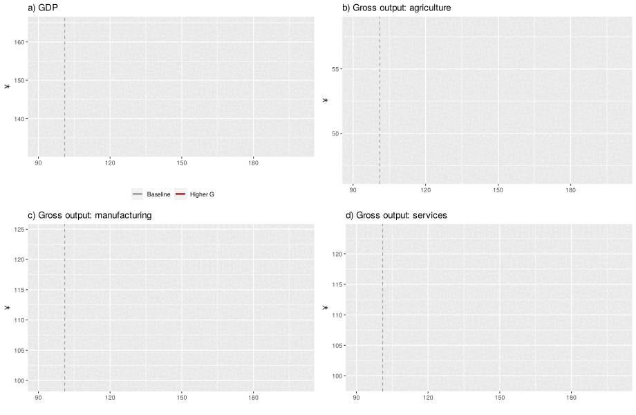
</figure>
<br>

**Second experiment: a change in the composition of public spending.** The second experiment is one that only a multi-industry model can address. At period 101, the government moves 30% of its spending from services to manufacturing ($\boldsymbol{\beta}_G$ changes from $[0.10, 0.30, 0.60]$ to $[0.10, 0.60, 0.30]$), while total spending is unchanged. Figure 10 compares two versions of the model: one with industry-specific capital intensities (red lines), and one with a single, aggregate capital-output ratio, as in Model SBM (grey lines).

#### Figure 10. Model IO-SBM: a change in the composition of public spending

<figure>
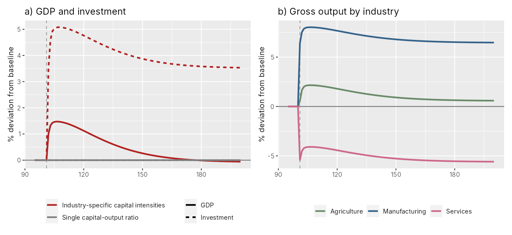
</figure>
<br>

With a single capital-output ratio, nothing happens at the macroeconomic level: the gross output of manufacturing rises and that of services falls, but GDP and investment do not change. With industry-specific capital intensities, the shift towards capital-intensive manufacturing raises the target capital stock. Investment rises by 3.5% on impact and by about 5% at its peak, and GDP rises by about 1% on impact and by 1.4% after ten periods. In the long run, the fiscal anchor prevails again and GDP returns to its baseline level. The economy, however, is not the same as before: the capital-output ratio is higher (about 1.54 against 1.49), investment remains about 3.5% above its baseline level to replace the larger capital stock, and consumption is correspondingly lower. Total employment *falls* slightly, because labour productivity is higher in manufacturing than in services: one unit of final demand for manufactured goods requires, directly and indirectly, about 0.50 units of labour, against 0.68 units for services.

**🎮 Interactive version.** A simulation laboratory for Model IO-SBM with fixed prices is available [here](https://marcoverpas.github.io/Beijing_lectures_2026/beijing_figures/int_io_sbm.html). It allows you to change the level and the composition of public spending, labour productivity in manufacturing, the propensities to consume, the tax rate and the interest rate, and shows gross output and employment by industry. As in Box B, new values apply from period 101 onwards, and the baseline is shown for comparison.

[](https://marcoverpas.github.io/Beijing_lectures_2026/beijing_figures/int_io_sbm.html)
<div align="center">
<figure>
<a href="https://marcoverpas.github.io/Beijing_lectures_2026/beijing_figures/int_io_sbm.html" target="_blank">

</a>
</figure>
</div>

#### 🛠️ Hands-on: the IO block in the code

The industry-level variables are stored in three-dimensional arrays, `[scenario, period, industry]`, so that `x[1, 100, ]` is the vector of gross outputs in the baseline at period 100. The IO parameters are defined at the top of `2a_IO_SBM.R`, and the Leontief inverse is computed only once, since $\mathbf{A}$ is constant:

```r
# Input-output parameters ####
nIndustries <- 3           # Industries (agriculture, manufacturing, services)
pr          <- c(3.5, 5, 2.2)         # Labour productivity by industry
betaC       <- c(0.15, 0.35, 0.50)    # Consumption shares by industry
betaI       <- c(0.20, 0.50, 0.30)    # Investment shares by industry
betaG       <- c(0.10, 0.30, 0.60)    # Government spending shares by industry
A  <- matrix(c(0.11, 0.12, 0.10,      # Technical coefficients
               0.21, 0.22, 0.20,      # (row: supplying industry; column: using industry)
               0.15, 0.18, 0.10), nrow = nIndustries, byrow = TRUE)
Leontief <- solve(diag(nIndustries) - A)   # (I - A)^-1, computed once (A is constant)
```

Inside the loop, the new block is placed after the equations of firms:

```r
      # INDUSTRIAL STRUCTURE ####
      d[j, i, ]  = betaC * C[j, i] + betaI * I[j, i] + betaG * G[j, i]      # Final demand by industry (19)
      x[j, i, ]  = Leontief %*% d[j, i, ]                                   # Gross output (20)
      Nz[j, i, ] = x[j, i, ] / pr                                           # Employment by industry (21)
```

The operator `%*%` is the matrix product in `R`, while `*` and `/` operate element by element.

> ### ✏️ Box G - Exercises with Model IO-SBM
>
> 1. **Changing consumption habits.** Shift consumption towards services, setting `betaC <- c(0.10, 0.25, 0.65)` in the second scenario (keep `G0` unchanged). What happens to GDP, investment and employment in the short run and in the long run? Compare the results with the second experiment above.
> 1. **Productivity growth.** Raise labour productivity in manufacturing from 5 to 6 in the second scenario. What happens to employment, income per worker and GDP? Why does national income not change?
> 1. **A change in technique.** Raise the technical coefficient $a_{21}$ (manufactured goods used in agriculture) from 0.21 to 0.30, setting `A[2, 1] <- 0.30; Leontief <- solve(diag(nIndustries) - A)` in the second scenario (the Leontief inverse must be recomputed, since it is calculated only once at the top of the script). How do the Leontief inverse and the output multipliers change? What happens to gross output and to the capital stock?
> 1. **Multipliers.** Compute the output multipliers, `colSums(Leontief)`, and the employment multipliers, `(1 / pr) %*% Leontief`. Which industry has the largest effect on total output, and which on total employment? Explain the difference.
>
> 👉 **Answers:** [here](ANSWERS.md#box-g---model-io-sbm).

### 3.3 - Closing the price system: Sraffa-like prices

📄 **R code:** [`2b_IO_SBM_SRAFFA.R`](2b_IO_SBM_SRAFFA.R)

In Model IO-SBM, all prices are fixed and equal to one. This is a convenient simplification, but it hides two important features of a multi-industry economy: relative prices reflect the technique of production and the distribution of income, and they can change when demand changes. In this section, we close the price system in an alternative way, using **Sraffa-like** prices. The quantity side of the model is unchanged. What changes is how prices are determined, and how nominal and real variables are linked. The code is in `2b_IO_SBM_SRAFFA.R`, and the price equations follow those of the IO-SFC model of Italy developed by [Canelli et al. (2026)](#references), without imported inputs.

**From Sraffa to cost-plus prices.** In [Sraffa's (1960)](#references) system of production prices, $\mathbf{p} = (1 + R) \cdot \mathbf{p} \cdot \mathbf{A} + w \cdot \mathbf{l}$, competition imposes a uniform rate of profit $R$ on the means of production of all industries. (An introduction to Sraffa's price system, from the reproduction of the economy to production prices, is available, in Italian, in [Section 2.3](https://github.com/marcoverpas/analisi_economica/blob/main/README.md#23-sraffa-e-la-ripresa-delle-teorie-del-sovrappi%C3%B9) of my lecture notes on *Analisi Economica*.) Here, we keep the structure of this system, but we replace the uniform rate of profit with industry-specific **mark-ups**, as is common in post-Keynesian pricing theory. Each industry sets its price by applying a mark-up to the cost of its intermediate inputs, and adding the cost of labour. For each of the three industries:

$$p_1 = m_1 \cdot (p_1 \cdot a_{11} + p_2 \cdot a_{21} + p_3 \cdot a_{31}) + w \cdot l_1$$

$$p_2 = m_2 \cdot (p_1 \cdot a_{12} + p_2 \cdot a_{22} + p_3 \cdot a_{32}) + w \cdot l_2$$

$$p_3 = m_3 \cdot (p_1 \cdot a_{13} + p_2 \cdot a_{23} + p_3 \cdot a_{33}) + w \cdot l_3$$

where $p_j$ is the price of good $j$, $w$ is the nominal wage rate (uniform across industries), $l_j = 1 / pr_j$ is the labour coefficient of industry $j$, and $m_j$ is a **mark-up factor**:

$$m_j = (1 + \kappa_j \cdot \delta) \cdot (1 + \mu_j)$$

The first term covers the cost of the capital used up in production, which is higher in capital-intensive industries. The second term is the mark-up proper, at the rate $\mu_j$. Notice that, in each equation, the cost of the inputs used to produce good $j$ is obtained from the $j$-th **column** of $\mathbf{A}$. Prices and labour coefficients form two **row** vectors, while the mark-up factors are collected in a diagonal matrix:

$$\mathbf{p} = \begin{bmatrix} p_1 & p_2 & p_3 \end{bmatrix}, \qquad \mathbf{l} = \begin{bmatrix} l_1 & l_2 & l_3 \end{bmatrix}, \qquad \mathbf{M} = \begin{bmatrix} m_1 & 0 & 0 \cr 0 & m_2 & 0 \cr 0 & 0 & m_3 \end{bmatrix}$$

so that the three price equations can be written in **extended form** as:

$$\begin{bmatrix} p_1 & p_2 & p_3 \end{bmatrix} = \begin{bmatrix} p_1 & p_2 & p_3 \end{bmatrix} \begin{bmatrix} a_{11} & a_{12} & a_{13} \cr a_{21} & a_{22} & a_{23} \cr a_{31} & a_{32} & a_{33} \end{bmatrix} \begin{bmatrix} m_1 & 0 & 0 \cr 0 & m_2 & 0 \cr 0 & 0 & m_3 \end{bmatrix} + w \begin{bmatrix} l_1 & l_2 & l_3 \end{bmatrix}$$

and, in **compact form**, as $\mathbf{p} = \mathbf{p} \cdot \mathbf{A} \cdot \mathbf{M} + w \cdot \mathbf{l}$. Bringing $\mathbf{p} \cdot \mathbf{A} \cdot \mathbf{M}$ to the left-hand side and solving for $\mathbf{p}$:

$$\mathbf{p} = w \cdot \mathbf{l} \cdot (\mathbf{I} - \mathbf{A} \cdot \mathbf{M})^{-1}$$

Prices are determined by the technique of production ($\mathbf{A}$ and $\mathbf{l}$), by the nominal wage rate and by the mark-ups, which govern the distribution of income between wages and profits. As in Sraffa's system, given the mark-ups, prices do not depend on the *levels* of output: unit prices depend only on the technique of production, which is described by ratios between quantities (the technical and labour coefficients), on the wage rate and on the mark-ups. Since the wage rate is given, prices are measured in terms of labour, and $w / p_j$ is the real wage in terms of good $j$.

**Reproduction prices and current prices.** When mark-ups are at their **normal** levels, $\mu_{0j}$, the price equations return the **reproduction prices** $\mathbf{p}^S$, that is, the prices that allow each industry to cover its costs and earn its normal profits. In the model, $\boldsymbol{\mu}_0 = [0.3, 0.4, 0.3]$, so that $\mathbf{p}^S \approx [0.93, 1.01, 0.98]$ with $w = 1$. Current prices, however, can diverge from reproduction prices when demand grows faster than expected. Following [Canelli et al. (2026)](#references), mark-ups rise when actual output exceeds its **normal** level, and normal output adjusts gradually to actual output:

$$x^N_j = x^N_{j,-1} + \phi_N \cdot (x_{j,-1} - x^N_{j,-1}) \quad \text{(27) [B]}$$

$$\mu_j = \mu_{0j} + \mu_1 \cdot \left( \frac{x_{j,-1}}{x^N_{j,-1}} - 1 \right) \quad \text{(28) [B]}$$

with $\mu_1 = 0.2$ and $\phi_N = 0.1$. When demand rises, firms raise their mark-ups and current prices rise above reproduction prices. As normal output catches up with actual output, mark-ups return to their normal levels and current prices converge back to reproduction prices. Demand affects relative prices and distribution in the short run, but not in the long run, which is consistent with the classical view that normal prices are governed by technique and distribution.

**Equations.** Model IO-SBM with Sraffa-like prices has 43 equations. In what follows, the numbers in brackets refer to the equations of the script of the model, `2b_IO_SBM_SRAFFA.R`. Besides the price block, three groups of equations change with respect to the fixed-price closure.

First, real and nominal variables must now be distinguished, and all the components of final demand are decided in real terms. Households decide their real consumption on the basis of their real disposable income and their real wealth, that is, their nominal values deflated by the consumer price index (5). Nominal consumption is real consumption times the consumer price index (6). Government spending is set in real terms, as in Model SBM, and its nominal value depends on the price of the goods purchased (10). Investment is also decided in real terms (20), and firms pay for it at the current price of investment goods (21):

$$C_r = \alpha_1 \cdot \frac{YD}{p_c} + \alpha_2 \cdot \frac{V_{-1}}{p_c} \quad \text{(5) [B]}, \qquad C = p_c \cdot C_r \quad \text{(6) [I]}$$

$$G = p_g \cdot G_r \quad \text{(10) [I]}, \qquad I = p_i \cdot I_r \quad \text{(21) [I]}$$

where the price indices are weighted averages of current prices, with the composition shares as weights: $p_c = \mathbf{p} \cdot \boldsymbol{\beta}_C$ (31), $p_i = \mathbf{p} \cdot \boldsymbol{\beta}_I$ (32) and $p_g = \mathbf{p} \cdot \boldsymbol{\beta}_G$ (33). Nominal GDP is the sum of nominal expenditures (equation (11) of the script), real GDP is the sum of real expenditures (12), and their ratio is the GDP deflator (13). The IO block now works in real terms: final demand by industry is computed from real consumption, investment and government spending (24).

**A note on money illusion.** Equation (5) leaves out a correction that is usually made when prices change. When prices rise, the real value of the wealth held by households falls, by $\pi \cdot V_{-1} / p_c$, where $\pi = p_c / p_{c,-1} - 1$ is the inflation rate. Following [Godley and Lavoie (2007, ch. 9)](#references), this loss can be subtracted from real disposable income, so that consumption depends on the Haig-Simons measure of real income, $YD / p_c - \pi \cdot V_{-1} / p_c$. Households then suffer no *money illusion*: they treat the erosion of their wealth by inflation as a loss of income, and cut their consumption at once. Without the correction, as in equation (5), households do not count the inflation loss on their wealth as a loss of income. They still react to it, but only gradually, through the lower real value of their wealth in the second term of the consumption function. This is a mild form of money illusion. We tested both specifications and decided to leave the correction out, for the sake of the stability of the model. In this model, prices respond to output through the mark-ups, and the correction feeds the current inflation rate, multiplied by a stock of wealth almost three times national income, directly into consumption in the same period. Small changes in output then cause large swings in consumption, which feed back on output. With the correction, the model becomes unstable, unless the mark-ups react only weakly to demand ($\mu_1 = 0.05$ rather than 0.2), and even then a one-off rise in prices has implausibly large effects: a 10% rise in the nominal wage reduces real GDP by about one third on impact, against about 5% without the correction. In the open-economy version of Section 3.4, the correction also makes the solution of each period much slower to converge. The long-run results are the same in both cases. Exercise 5 of Box H asks you to compare the two specifications.

Second, the distribution of income is now determined by prices. The wage bill is no longer a residual: it is the nominal wage rate times employment (15). It is now **profits** that are the residual, and they are entirely distributed to households, who pay taxes on them (1)-(2):

$$WB = w \cdot N \quad \text{(15) [I]}$$

$$F_f = Y - WB - AF - r_{l,-1} \cdot L_{d,-1} \quad \text{(16) [I]}$$

Third, amortisation funds are set aside at the replacement cost of capital, $AF = p_i \cdot DA$ (19), and the fiscal rule is expressed in real terms (39). The other equations are unchanged: in particular, wealth, income and the portfolio choices of households are still expressed in nominal terms. In the transactions-flow matrix, the only change is a new row recording the distributed profits of firms ($+F_f$ for households, $-F_f$ for the current account of firms).

**An experiment: higher government spending.** Real government spending rises from ¥20 to ¥25 at period 101. Figure 11 shows the results. Real GDP follows a path similar to that of the fixed-price closure, rising from about ¥130 to about ¥163 (at constant prices). As output exceeds its normal level, mark-ups rise, and so do prices: the GDP deflator rises by about 2.5% within four periods. Since the nominal wage rate is fixed, the real wage falls by about 2.4%. The rise in prices is temporary: as normal output catches up with actual output, mark-ups return to their normal levels, and prices and the real wage go back to their baseline levels after about 70 periods.

#### Figure 11. Model IO-SBM with Sraffa-like prices: higher government spending

<figure>
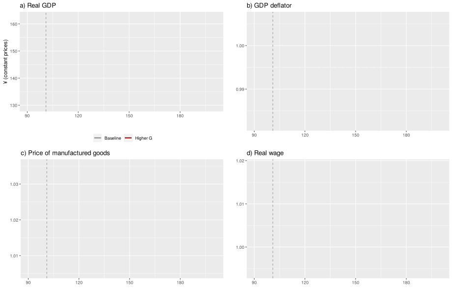
</figure>
<br>

Figure 12 looks more closely at relative prices and distribution. Panel a) shows the gap between current and reproduction prices in the scenario with higher government spending, measured as a difference from the baseline, so that it is zero before the shock. Current prices rise above reproduction prices in all three industries, but not by the same amount: by up to 2.9% in manufacturing, 2.5% in agriculture and 2.0% in services. Since mark-ups apply to intermediate costs, the increase is largest where intermediate inputs weigh most on total costs, and where the normal mark-up is highest. Relative prices therefore change during the adjustment. The fiscal expansion also redistributes income (panel b): the profit share of GDP rises from about 21% to 24% within four periods, and then gradually returns to its normal level.

#### Figure 12. Model IO-SBM with Sraffa-like prices: relative prices and the profit share

<figure>
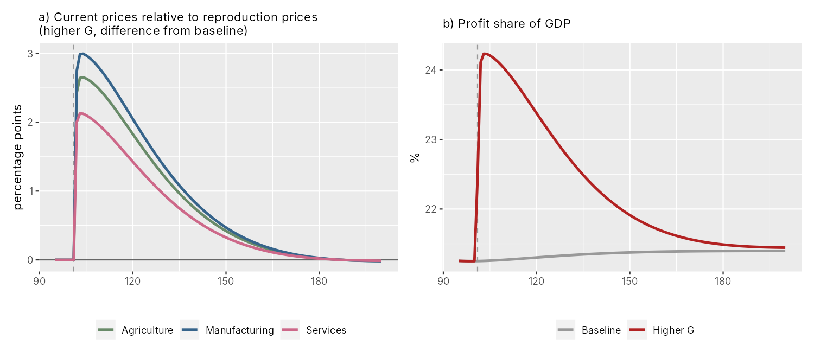
</figure>
<br>

#### 🛠️ Hands-on: the price block in the code

The price block is placed after the IO block. Reproduction prices are computed with the normal mark-up factors (`MkN`, defined at the top of the script), and current prices with the current mark-ups:

```r
      # PRICES ####
      xN[j, i, ] = if (i < 3) x[j, i, ] else xN[j, i - 1, ] + phiN * (x[j, i - 1, ] - xN[j, i - 1, ])  # Normal output (27)
      mup[j, i, ] = if (i < 3) mup0 else mup0 + mup1 * (x[j, i - 1, ] / xN[j, i - 1, ] - 1)  # Current mark-ups (28)
      pS[j, i, ] = as.vector(wbar * lab %*% solve(diag(nIndustries) - A %*% MkN))  # Reproduction prices (29)
      p[j, i, ]  = as.vector(wbar * lab %*% solve(diag(nIndustries) -
                               A %*% diag((1 + kappaj * delta) * (1 + mup[j, i, ]))))  # Current prices (30)
      p_c[j, i]  = sum(p[j, i, ] * betaC)                                   # Consumer price index (31)
      p_i[j, i]  = sum(p[j, i, ] * betaI)                                   # Price of investment goods (32)
      p_g[j, i]  = sum(p[j, i, ] * betaG)                                   # Price of government purchases (33)
```

Notice that `lab` is a row vector, which pre-multiplies the inverse matrix, while in the IO block the Leontief inverse is post-multiplied by the column vector of final demands. In the first two periods, normal output and mark-ups are set at their initial values, since the lagged values needed by equations (27) and (28) are not yet available.

> ### ✏️ Box H - Exercises with Model IO-SBM and Sraffa-like prices
>
> 1. **Market power.** Raise the normal mark-up in manufacturing from 0.4 to 0.6, setting `mup0 <- c(0.3, 0.6, 0.3)` at the top of the script, and compare the results with the original ones. How do reproduction prices change, and why do the prices of the other two goods also rise? What happens to the real wage, the profit share and real GDP?
> 1. **Rigid mark-ups.** Set `mup1 <- 0`, so that mark-ups never depart from their normal levels, and repeat the government-spending experiment. What happens to prices and to the real wage? Is the path of real GDP affected?
> 1. **Productivity growth, again.** Raise labour productivity in manufacturing from 5 to 6, as in exercise 2 of Box G. Since prices depend on labour coefficients, set `lab[2] <- 1 / 6` in the second scenario. Unlike the fixed-price closure, prices now change: which prices fall, and by how much? What happens to the real wage and to real GDP?
> 1. **Nominal wages.** Raise the nominal wage rate `wbar` from 1 to 1.1 in the second scenario. What happens to relative prices? And to real variables?
> 1. **Money illusion.** Add the correction for inflation to the consumption function, replacing `YD[j, i]` with `(YD[j, i] - (p_c[j, i] / p_c[j, i - 1] - 1) * V[j, i - 1])` in equation (5). Run the government-spending experiment: what happens, and why? Now set `mup1 <- 0.05`, run the experiment again, and then repeat exercise 4. How do the results compare with those obtained without the correction?
>
> 👉 **Answers:** [here](ANSWERS.md#box-h---model-io-sbm-with-sraffa-like-prices).

### 3.4 - Open-economy versions

> 📚 **Extra material.** This section extends the models of Sections 3.2 and 3.3 to the open economy, and can be skipped on a first reading.

📄 **R code:** [`2c_IO_OPENSBM.R`](2c_IO_OPENSBM.R) (fixed prices) · [`2d_IO_OPENSBM_SRAFFA.R`](2d_IO_OPENSBM_SRAFFA.R) (Sraffa-like prices)

The two closures of Model IO-SBM can be extended to the open economy along the lines of Model OPENSBM-FLEX (Section 2.2). The foreign sector is the same: exports depend on foreign income, imports on domestic income, both depend on relative prices, and the exchange rate floats. What the IO structure adds is a description of **which industries export and which goods are imported**, following the treatment of foreign trade in [Canelli et al. (2026)](#references). The code is in `2c_IO_OPENSBM.R` (fixed prices) and `2d_IO_OPENSBM_SRAFFA.R` (Sraffa-like prices). Since the main mechanisms have already been discussed, this section only highlights what is new.

**Trade in the IO block.** Exports are allocated to industries by fixed shares, collected in the vector $\boldsymbol{\chi} = [0.2, 0.6, 0.2]$: most exports are manufactured goods. Imports have two components. **Intermediate imports** are inputs bought abroad by domestic industries, described by a matrix of imported-input coefficients $\mathbf{A}_m$, whose element $a^m_{ij}$ is the amount of foreign good $i$ needed to produce one unit of domestic good $j$. **Final imports** are foreign goods bought directly by households, firms and the government. Their import content differs across goods and components of demand: for instance, 40% of the manufactured goods consumed by households are imported, against 5% of services. In `2c_IO_OPENSBM.R`, the block is:

$$\mathbf{d} = \boldsymbol{\beta}_C \cdot C + \boldsymbol{\beta}_I \cdot I + \boldsymbol{\beta}_G \cdot G + \boldsymbol{\chi} \cdot X \quad \text{(21)}$$

$$\mathbf{d}^{pat} = \boldsymbol{\Psi}_C \odot \boldsymbol{\beta}_C \cdot C + \boldsymbol{\Psi}_I \odot \boldsymbol{\beta}_I \cdot I + \boldsymbol{\Psi}_G \odot \boldsymbol{\beta}_G \cdot G \quad \text{(22)}$$

$$\mathbf{d}^{dom} = \mathbf{d} - \mathbf{d}^{im} \quad \text{(23)}$$

$$\mathbf{x} = (\mathbf{I} - \mathbf{A})^{-1} \cdot \mathbf{d}^{dom} \quad \text{(24)}$$

$$\mathbf{im}^{int} = \mathbf{A}_m \cdot \mathbf{x} \quad \text{(25)}$$

$$\mathbf{d}^{im} = \mathbf{d}^{pat} \cdot \frac{IM - \sum_j im^{int}_j}{\sum_j d^{pat}_j} \quad \text{(26)}$$

where $\odot$ denotes the element-by-element (Hadamard) product. Final demand now includes exports (21). The vectors $\boldsymbol{\Psi}_C$, $\boldsymbol{\Psi}_I$ and $\boldsymbol{\Psi}_G$ contain the import contents of each component of demand, which define the *pattern* of final imports across goods (22). Only the part of final demand that is met by domestic production enters the Leontief system (23)-(24), and domestic production in turn requires intermediate imports (25). Total imports are still determined by the aggregate import equation of Model OPENSBM-FLEX. Final imports are therefore obtained as a residual, the difference between total imports and intermediate imports, and are allocated across goods according to the import pattern (26). In other words, the macroeconomic block determines *how much* is imported, while the IO block determines *what* is imported and *which* industries lose domestic demand to foreign producers.

**Fixed prices.** With fixed prices, the open IO model behaves at the macroeconomic level like Model OPENSBM-FLEX. After the increase in government spending, national income rises to about 165, and the domestic currency depreciates by about 15%. The new information concerns industries: since exports are concentrated in manufacturing, the depreciation benefits manufacturing slightly more than the other industries.

**Sraffa-like prices.** When prices are Sraffa-like, the open economy raises a new issue: the cost of imported inputs enters domestic prices. The price of each good now covers the cost of domestic *and* imported inputs, both marked up, plus the cost of labour. For each industry:

$$p_j = m_j \cdot \left( \sum_i p_i \cdot a_{ij} + xr \cdot \sum_i p^f_i \cdot a^m_{ij} \right) + w \cdot l_j$$

where $p^f_i$ is the price of foreign good $i$ in foreign currency. In compact form, $\mathbf{p} = \mathbf{p} \cdot \mathbf{A} \cdot \mathbf{M} + xr \cdot \mathbf{p}^f \cdot \mathbf{A}_m \cdot \mathbf{M} + w \cdot \mathbf{l}$, whose solution is:

$$\mathbf{p} = \left( xr \cdot \mathbf{p}^f \cdot \mathbf{A}_m \cdot \mathbf{M} + w \cdot \mathbf{l} \right) \cdot (\mathbf{I} - \mathbf{A} \cdot \mathbf{M})^{-1}$$

In the code, prices are then divided by their base-period values, so that they are equal to one when $xr = 1$ and mark-ups are at their normal levels (equations (35)-(36) of `2d_IO_OPENSBM_SRAFFA.R`). A depreciation of the domestic currency raises the cost of imported inputs and, through the mark-ups and the inter-industry linkages, all domestic prices: this is the **exchange-rate pass-through**. Consistently, exports and imports now depend on the ratio between the price of imports, $p_m$, and the price of exports, $p_x$, rather than on the nominal exchange rate alone (equations (52)-(53)).

Figure 13 shows the government-spending experiment in Model IO-OPENSBM with Sraffa-like prices. Because the price-exchange rate loop converges slowly, the model runs for 400 periods, and the shock hits at period 201.

#### Figure 13. Model IO-OPENSBM with Sraffa-like prices: higher government spending

<figure>
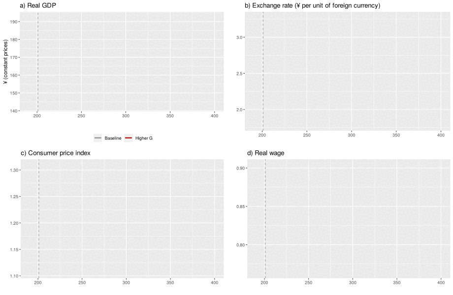
</figure>
<br>

The results differ markedly from those of the fixed-price closure. First, the domestic currency depreciates by about 80%, rather than 15%. This large depreciation is not due to the reaction of mark-ups to demand, which only lasts during the adjustment: with rigid mark-ups ($\mu_1 = 0$), the long-run depreciation is the same. Since the depreciation raises the price of exports too (by about 19%), a much larger fall in the value of the currency is needed to improve competitiveness and bring the current account back into balance. Second, the depreciation is passed through to domestic prices: the consumer price index rises by about 18%, and since the nominal wage is fixed, the real wage falls by about 15%. Unlike the temporary rise in mark-ups of Section 3.3, this fall is **permanent**, because it reflects a permanent change in relative costs. Correspondingly, the profit share of GDP rises from about 18% to 23%. Third, real GDP rises by about 35%, more than government spending. The reason is a deterioration of the terms of trade: since imported goods have become more expensive, the economy must export more goods (real exports rise by 40%) to pay for a smaller volume of imports.

> ### ✏️ Box I - Exercises with the open IO models
>
> 1. **Import content.** In `2c_IO_OPENSBM.R`, raise the import content of consumption to `psiC <- c(0.30, 0.60, 0.10)` in the second scenario (keep `G0` unchanged). What happens to gross output by industry and to national income? Why is national income almost unaffected? (Hint: which equation determines total imports?)
> 1. **Pass-through.** Compare the government-spending experiment in `2c_IO_OPENSBM.R` and `2d_IO_OPENSBM_SRAFFA.R`. Why does the exchange rate depreciate so much more when prices are Sraffa-like? (Hint: plot the ratio `p_m / p_x` in the two scenarios.)
> 1. **A foreign boom.** Raise foreign income `yw` from 200 to 220 in the second scenario of `2d_IO_OPENSBM_SRAFFA.R`. What happens to the exchange rate, the consumer price index and the real wage? Who gains from the foreign boom?
>
> 👉 **Answers:** [here](ANSWERS.md#box-i---open-io-models).

---

## 4 - Ecological models

This section embeds the IO economy of Section 3 in the **ecosystem**. Production requires energy and matter, the use of non-renewable energy generates CO<sub>2</sub> emissions, cumulative emissions raise the temperature, and global warming feeds back on the economy. Section 4.1 introduces ecological macroeconomics and ecological SFC models. Section 4.2 presents the climate block, and Section 4.3 the full ecological block, which also tracks matter, waste and the depletion of natural reserves. Section 4.4 extends both versions to the open economy. All the ecological models are built on the fixed-price closure of Model IO-SBM.

### 4.1 - Ecological macroeconomics and ecological SFC models

To address environmental questions, mainstream economists mostly rely on integrated assessment models (IAMs), which link a model of the economy to a model of the climate system to assess mitigation scenarios or estimate the social cost of carbon. The economic block of IAMs is usually either an optimal growth model or a computable general equilibrium (CGE) model, and this is where the problem lies. CGE models are large-scale and grounded in input-output and national accounts data, which makes them rich in industrial detail, but they rest on neoclassical foundations: optimising agents, a unique and stable equilibrium, supply-determined output, and a comparison between pre-shock and post-shock states that says little about the transition in between. Money, debt and financial stability are usually absent.

**Ecological macroeconomics** starts from the opposite end: the economy is an open subsystem of a finite ecosystem, from which it extracts matter and energy and into which it releases waste and emissions ([Georgescu-Roegen, 1971](#references)). The two laws of thermodynamics apply: matter and energy can be neither created nor destroyed (first law), and their use degrades them into forms that are less available for future use (second law). Ecological SFC models bring this view into the SFC framework, by combining the monetary accounting of [Godley and Lavoie (2007)](#references) with a consistent physical accounting of matter, energy and emissions ([Jackson and Victor, 2015](#references); [Dafermos et al., 2017, 2018](#references); for reviews, see [Hardt and O'Neill, 2017](#references); [Fevereiro et al., 2025](#references)). Just as the transactions-flow matrix ensures that every monetary flow comes from somewhere and goes somewhere, physical flow matrices ensure that every tonne of matter extracted from the ground ends up somewhere: in the socio-economic stock, in waste, or in the atmosphere. Simple ecological SFC models, built on Model PC, are presented step by step in the [EAEPE Summer School](https://github.com/marcoverpas/EAEPE_summer_school_2024#4_model_eco-io-pc), the [Florence keynote speech](https://github.com/marcoverpas/keynote_speech_Florence#23---model-eco-3io-pc) and the [Six lectures on SFC models](https://github.com/marcoverpas/Six_lectures_on_sfc_models#4_introducing_the_ecosystem).

The IO structure is a natural partner for the ecological block. Energy and material intensities differ widely across industries, so that the environmental impact of the economy depends not only on the *level* of output, but also on its *composition*. In our models, each industry has its own energy intensity, renewable energy share and material intensity, and emissions are computed industry by industry.

**Feedbacks and the fiscal anchor.** An ecological model must also say how environmental damage affects the economy. Following the literature, the most common choice is to let warming destroy part of the capital stock, or reduce productivity or demand. In Model SBM, however, the long-run level of national income is pinned down by the fiscal anchor (Section 2.1), and some of these channels can paradoxically *raise* long-run output: for instance, if climate change destroys capital, firms must invest more to replace it, which raises demand. In our models, we therefore let warming affect the **investment decisions** of firms: the higher the temperature anomaly, the lower the target capital stock. This captures, in a very stylised way, the idea that a warmer and riskier world makes firms less willing to accumulate capital. As shown below, it lowers both investment and national income.

### 4.2 - Model ECO-IO-SBM: the climate block

📄 **R code:** [`3a_ECO_IO_SBM_CLIMATE.R`](3a_ECO_IO_SBM_CLIMATE.R)

Model **ECO-IO-SBM** with the climate block is Model IO-SBM plus nine equations. The code is in `3a_ECO_IO_SBM_CLIMATE.R`, and the model has 40 equations. The key additional assumptions are:

1. Production requires energy, in fixed proportions that differ across industries
1. Energy is either renewable or non-renewable, and only non-renewable energy generates CO<sub>2</sub> emissions
1. The CO<sub>2</sub> intensity of non-renewable energy declines at a constant rate, reflecting autonomous technical progress
1. The temperature anomaly is proportional to cumulative CO<sub>2</sub> emissions
1. Warming reduces the target capital stock of firms

**Equations.** Total energy use is the sum of the energy required by the three industries, given their energy intensities $\epsilon_j$ (22). A share $\eta_j$ of the energy used by each industry is renewable (23), and the rest is non-renewable (24):

$$EN = \sum_j \epsilon_j \cdot x_j \quad \text{(22) [B]}$$

$$REN = \sum_j \epsilon_j \cdot \eta_j \cdot x_j \quad \text{(23) [B]}$$

$$NEN = EN - REN \quad \text{(24) [I]}$$

CO<sub>2</sub> emissions are proportional to non-renewable energy (26), with a CO<sub>2</sub> intensity $\upsilon$ that declines at the rate $g_{\upsilon}$ (25). Emissions are also computed industry by industry (27), and accumulate in the atmosphere (28):

$$\upsilon = \upsilon_{-1} \cdot (1 - g_{\upsilon}) \quad \text{(25) [B]}$$

$$EMIS = \upsilon \cdot NEN \quad \text{(26) [B]}$$

$$EMIS_j = \upsilon \cdot \epsilon_j \cdot (1 - \eta_j) \cdot x_j \quad \text{(27) [B]}$$

$$CO2_{cum} = CO2_{cum,-1} + EMIS \quad \text{(28) [I]}$$

Following the climate-science literature ([Matthews et al., 2009](#references)), the temperature anomaly is a linear function of cumulative emissions, through the **transient climate response to cumulative carbon emissions** (TCRE), corrected for the contribution of non-CO<sub>2</sub> forcing, $f_{nc}$ (29). The coefficient $car = 3.67$ converts tonnes of CO<sub>2</sub> into tonnes of carbon. Since all these coefficients are constant, the temperature anomaly is the initial anomaly plus a constant, $\tau$, times cumulative emissions. Finally, the climate factor $\omega$ reduces the target capital-output ratios of all industries as the temperature rises above its initial level (30), so that the target capital stock becomes $K^T = \omega \cdot \sum_j \kappa_j \cdot x_{j,-1}$ (13). Denoting the temperature anomaly by $TEMP$, to avoid confusion with taxes:

$$TEMP = TEMP_0 + \tau \cdot CO2_{cum}, \quad \text{with} \quad \tau = \frac{TCRE}{(1 - f_{nc}) \cdot car} \quad \text{(29) [B]}$$

$$\omega = 1 - \omega_1 \cdot (TEMP_{-1} - TEMP_0) \quad \text{(30) [B]}$$

The energy intensities are $\boldsymbol{\epsilon} = [4, 3, 1.5]$ EJ per unit of output, so that agriculture is the most energy-intensive industry, and the renewable shares are $\boldsymbol{\eta} = [0.12, 0.15, 0.18]$. The initial temperature anomaly is $TEMP_0 = 1.2$°C, roughly its current level, and $TCRE = 1.65$°C per 1,000 GtC. The ecological block is calibrated loosely on world magnitudes (total energy use is about 600 EJ), so that the model is best read as a stylised representation of the world economy. With $\omega_1 = 0.2$, each additional degree of warming reduces the target capital stock by 20%. This is a strong and purely illustrative assumption.

**The baseline.** The ecological block changes the baseline itself. As the economy grows, emissions rise to a peak of about 24 Gt of CO<sub>2</sub> around period 27, and then decline, as the CO<sub>2</sub> intensity of energy falls while output stabilises. Since temperature depends on *cumulative* emissions, however, it keeps rising: from 1.2°C to about 2.5°C at period 100 and 3.1°C at period 200. As warming reduces the target capital stock, the investment share of GDP falls from about 14% to 9%, and national income is lower than in Model IO-SBM (about ¥128 against ¥132 at period 100). Manufacturing generates almost half of all emissions (47%), agriculture about 30% and services 23%.

**An experiment: higher government spending.** Figure 14 shows the usual increase in government spending at period 101, this time over the whole simulation period. The fiscal expansion raises GDP to about ¥163 at period 200, slightly less than in Model IO-SBM. Higher output requires more energy and generates more emissions (6.3 against 5.1 Gt at period 200), and the temperature anomaly at period 200 is about 0.1°C higher (3.21°C against 3.10°C). The additional warming further reduces the target capital stock, and the investment share of GDP is slightly lower than in the baseline. The experiment illustrates the basic dilemma of ecological macroeconomics: in the absence of structural change, more output means more emissions and more warming.

#### Figure 14. Model ECO-IO-SBM: higher government spending

<figure>
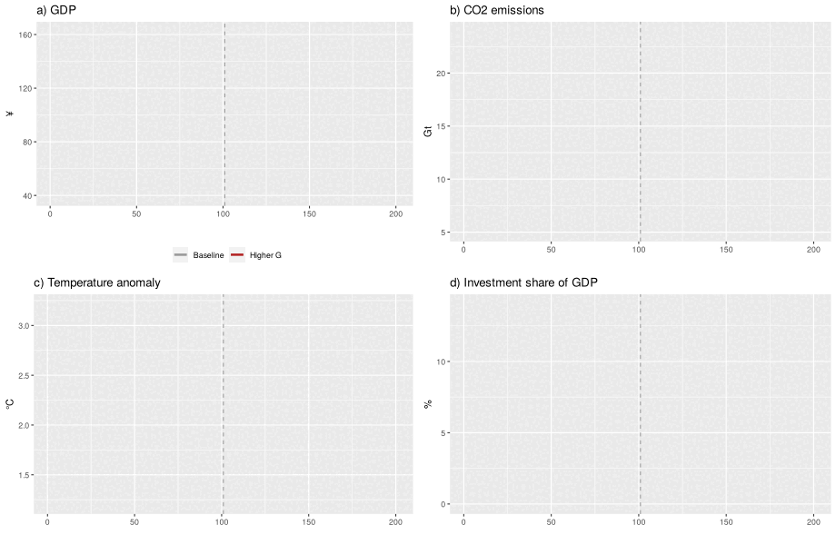
</figure>
<br>

**🎮 Interactive version.** A simulation laboratory for Model ECO-IO-SBM is available [here](https://marcoverpas.github.io/Beijing_lectures_2026/beijing_figures/int_eco_io_sbm.html). It allows you to change public spending, the share of renewable energy, the rate of decline of the CO<sub>2</sub> intensity of energy, the share of consumption spent on services and the sensitivity of investment to warming, and shows emissions, temperature and energy use over the whole simulation period. As in Box B, new values apply from period 101 onwards, and the baseline is shown for comparison.

[](https://marcoverpas.github.io/Beijing_lectures_2026/beijing_figures/int_eco_io_sbm.html)
<div align="center">
<figure>
<a href="https://marcoverpas.github.io/Beijing_lectures_2026/beijing_figures/int_eco_io_sbm.html" target="_blank">

</a>
</figure>
</div>

#### 🛠️ Hands-on: the ecological block in the code

The ecological block is placed after the IO block in `3a_ECO_IO_SBM_CLIMATE.R`, since it needs the vector of gross outputs:

```r
      # E) ECOSYSTEM ####
      EN[j, i]   = sum(eps_en * x[j, i, ])                                  # Energy required for production (22)
      REN[j, i]  = sum(eps_en * eta_en * x[j, i, ])                         # Renewable energy (23)
      NEN[j, i]  = EN[j, i] - REN[j, i]                                     # Non-renewable energy (24)
      beta_e[j, i] = beta_e[j, i - 1] * (1 - g_beta_e)                      # Declining CO2 intensity (25)
      EMIS[j, i] = beta_e[j, i] * NEN[j, i]                                 # CO2 emissions (26)
      EMISz[j, i, ] = beta_e[j, i] * eps_en * (1 - eta_en) * x[j, i, ]      # CO2 emissions by industry (27)
      CO2c[j, i] = CO2c[j, i - 1] + EMIS[j, i]                              # Cumulative emissions (28)
      TEMP[j, i] = temp0 + tau * CO2c[j, i]                                   # Temperature anomaly (29)
      omega[j, i] = 1 - omega1 * (TEMP[j, i - 1] - temp0)               # Warming and target capital (30)
```

Notice that `sum(eps_en * x[j, i, ])` is the scalar product between the vector of energy intensities and the vector of gross outputs, $\boldsymbol{\epsilon} \cdot \mathbf{x}$. The scalar $\tau$ is defined among the parameters, as `tau <- tcre / ((1 - fnc) * car)`.

> ### ✏️ Box J - Exercises with Model ECO-IO-SBM (climate block)
>
> 1. **Faster decarbonisation.** Double the rate of decline of the CO<sub>2</sub> intensity of energy, setting `g_beta_e <- 0.02` at the top of the script. What happens to emissions, temperature and GDP?
> 1. **A greener energy mix.** Raise the share of renewable energy to 30% in all industries from period 101, setting `eta_en <- c(0.3, 0.3, 0.3)` in the second scenario (keep `G0` unchanged). Compare the effect on temperature with that of the fiscal expansion.
> 1. **Structural change.** Shift consumption towards services, setting `betaC <- c(0.10, 0.25, 0.65)` in the second scenario. What happens to emissions and temperature? And to GDP?
> 1. **No feedback.** Set `omega1 <- 0`. How much lower is GDP in the baseline because of climate change? Is the temperature at period 200 higher or lower without the feedback? Why?
>
> 👉 **Answers:** [here](ANSWERS.md#box-j---model-eco-io-sbm-climate-block).

### 4.3 - Model ECO-IO-SBM-FULL: the full ecological block

> 📚 **Extra material.** This section extends the climate block of Section 4.2 to matter, and can be skipped on a first reading.

📄 **R code:** [`3b_ECO_IO_SBM_FULL.R`](3b_ECO_IO_SBM_FULL.R)

The climate block only considers energy and emissions. The full ecological block of Model **ECO-IO-SBM-FULL**, in `3b_ECO_IO_SBM_FULL.R`, also tracks **matter**: the extraction of raw materials, the accumulation of durable goods, their discard, recycling and waste, and the depletion of matter and energy reserves. The model has 56 equations, and the additional ones follow [Dafermos et al. (2017)](#references) and Model ECO-3IO-PC of the [Florence keynote speech](https://github.com/marcoverpas/keynote_speech_Florence#23---model-eco-3io-pc). The key additional assumptions are:

1. Production requires matter, in fixed proportions that differ across industries
1. Part of the consumption goods are durable; only durable goods accumulate in the socio-economic stock, while the material content of non-durable goods and intermediate inputs becomes waste within the period
1. A share of the socio-economic stock is discarded in every period, and part of it is recycled
1. Matter and energy resources are converted into reserves at a constant rate, and reserves are depleted by extraction

**Equations.** The material content of output is the sum of the material intensities $\nu_j$ times gross outputs (31). Part of it is covered by recycled matter (33), which is a share $\rho$ of the discarded socio-economic stock (34); the rest must be extracted (32):

$$MC = \sum_j \nu_j \cdot x_j \quad \text{(31)}$$

$$MAT = MC - REC \quad \text{(32)}$$

$$REC = \rho \cdot DIS \quad \text{(33)}$$

$$DIS = \sum_j \nu_j \cdot \zeta_j \cdot DC_{j,-1} \quad \text{(34)}$$

A share $\xi_j$ of the consumption goods of each industry is durable, and the stock of durable goods is discarded at the rate $\zeta_j$ (35). The material content of new durable goods (36) adds to the socio-economic stock, from which discarded goods are subtracted (37). Waste is the matter extracted that does not accumulate in the socio-economic stock (38):

$$DC_j = DC_{j,-1} + \xi_j \cdot \beta_{C,j} \cdot C - \zeta_j \cdot DC_{j,-1} \quad \text{(35)}$$

$$MC_{dur} = \sum_j \nu_j \cdot \xi_j \cdot \beta_{C,j} \cdot C \quad \text{(36)}$$

$$SES = SES_{-1} + MC_{dur} - DIS \quad \text{(37)}$$

$$WA = MAT - \Delta SES \quad \text{(38)}$$

Finally, resources are converted into reserves at the rates $\sigma_m$ and $\sigma_e$, and reserves are depleted by the extraction of matter and the use of non-renewable energy (39)-(44). The carbon mass of non-renewable energy and the mass of oxygen used in combustion close the material balance (45)-(46):

$$RSV_m = RSV_{m,-1} + \sigma_m \cdot RES_{m,-1} - MAT, \qquad RSV_e = RSV_{e,-1} + \sigma_e \cdot RES_{e,-1} - NEN$$

$$CEN = \frac{EMIS}{car}, \qquad O2 = EMIS - CEN$$

**Physical matrices.** The physical side of the model can be represented by two matrices, which play the same role as the balance-sheet and transactions-flow matrices of the monetary side. The **physical flow matrix** (Table 11) shows that, in every period, the inputs of matter and energy are equal to the outputs, as required by the first law of thermodynamics. Matter is measured in Gt and energy in EJ.

#### Table 11. Physical flow matrix of Model ECO-IO-SBM-FULL

|                                              | Matter                        | Energy    |
|:---------------------------------------------|:-----------------------------:|:---------:|
| **Inputs**                                   |                               |           |
| Extracted matter                             | $+MAT$                        |           |
| Recycled socio-economic stock                | $+REC$                        |           |
| Renewable energy                             |                               | $+REN$    |
| Non-renewable energy                         | $+CEN$                        | $+NEN$    |
| Oxygen                                       | $+O2$                         |           |
| **Outputs**                                  |                               |           |
| Industrial CO<sub>2</sub> emissions          | $-EMIS$                       |           |
| Discarded socio-economic stock               | $-DIS$                        |           |
| Non-durable goods and intermediate inputs    | $-(MC - MC_{dur})$        |           |
| Dissipated energy                            |                               | $-EN$     |
| Change in socio-economic stock               | $-\Delta SES$                 |           |
| **Total**                                    | 0                             | 0         |

The **physical stock-flow matrix** (Table 12) shows how the flows change the stocks of matter and energy reserves, atmospheric CO<sub>2</sub> and the socio-economic stock (SES).

#### Table 12. Physical stock-flow matrix of Model ECO-IO-SBM-FULL

|                                          | Matter reserves   | Energy reserves   | Atmospheric CO<sub>2</sub> | SES           |
|:-----------------------------------------|:-----------------:|:-----------------:|:--------------------------:|:-------------:|
| **Initial stock**                        | $RSV_{m,-1}$        | $RSV_{e,-1}$        | $CO2_{cum,-1}$             | $SES_{-1}$    |
| Resources converted into reserves        | $+CONV_m$         | $+CONV_e$         |                            |               |
| CO<sub>2</sub> emissions                 |                   |                   | $+EMIS$                    |               |
| Production of durable consumption goods  |                   |                   |                            | $+MC_{dur}$    |
| Extraction of matter / use of energy     | $-MAT$            | $-NEN$            |                            |               |
| Discarded socio-economic stock           |                   |                   |                            | $-DIS$        |
| **Final stock**                          | $RSV_m$             | $RSV_e$             | $CO2_{cum}$                | $SES$         |

**Results.** Since the matter block has no feedback on the economy, the monetary side and the climate block behave exactly as in Section 4.2. Figure 15 shows the new information. Panel a) displays CO<sub>2</sub> emissions by industry in the baseline. Panel b) shows that, after the fiscal expansion, extraction and waste rise by about a quarter (extraction from about 43 to 54 Gt at period 200), while recycling covers only about 11% of the material content of output. Panel c) shows that higher output accelerates the depletion of reserves: at period 200, energy reserves are about 68% of their initial level with higher government spending, against 98% in the baseline, and matter reserves about 76% against 92%.

#### Figure 15. Model ECO-IO-SBM-FULL: emissions by industry, matter flows and reserves

<figure>
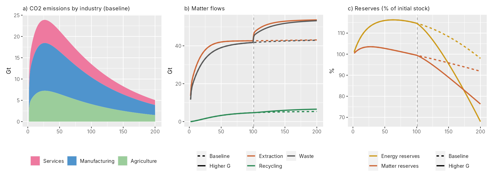
</figure>
<br>

### 4.4 - Open-economy versions

> 📚 **Extra material.** This section extends the ecological models of Sections 4.2 and 4.3 to the open economy, and can be skipped on a first reading.

📄 **R code:** [`3c_ECO_IO_OPENSBM_CLIMATE.R`](3c_ECO_IO_OPENSBM_CLIMATE.R) (climate block) · [`3d_ECO_IO_OPENSBM_FULL.R`](3d_ECO_IO_OPENSBM_FULL.R) (full ecological block)

The open-economy versions, Model ECO-IO-OPENSBM (`3c_ECO_IO_OPENSBM_CLIMATE.R`, 53 equations) and Model ECO-IO-OPENSBM-FULL (`3d_ECO_IO_OPENSBM_FULL.R`, 69 equations), add the ecological blocks to the fixed-price open IO model of Section 3.4. Since the ecological block is computed from domestic gross output, emissions are **production-based**: the emissions generated abroad to produce the goods imported by the domestic economy are not counted, while those generated at home to produce exports are. This is the standard convention in national emission inventories, but it can give a misleading picture of the environmental responsibility of an economy, since part of the emissions associated with its consumption may be "outsourced" to the rest of the world (carbon leakage). The distinction between production-based and consumption-based emissions is particularly relevant for an export-oriented economy like China.

In the baseline, the gross output of the open economy is larger than that of the closed economy, because domestic industries also produce for export, and exports are concentrated in energy-intensive manufacturing. As a result, emissions are higher, and the temperature anomaly at period 200 is about 3.24°C, against 3.10°C. The fiscal expansion raises it to about 3.37°C. Model ECO-IO-OPENSBM-FULL behaves in the same way, with the addition of the matter block. Extending these models with consumption-based emissions would require a description of the technology of the rest of the world, for instance through a multi-regional IO table: this is a natural next step, which we leave to the reader.

> ### ✏️ Box K - Exercises with the full ecological block
>
> 1. **Recycling.** Raise the recycling rate `rho_dis` from 0.5 to 0.8 in the second scenario of `3b_ECO_IO_SBM_FULL.R` (keep `G0` unchanged). What happens to extraction, waste and matter reserves? Does GDP change?
> 1. **Durability.** Halve the discard rates of durable goods, setting `zeta_dc <- c(0.025, 0.035, 0.020) / 2` in the second scenario. What happens to the socio-economic stock, discards and waste?
> 1. **The physical flow matrix.** After running `3b_ECO_IO_SBM_FULL.R`, check that the matter column of Table 11 adds up to zero in every period: `MAT + REC + CEN + O2 - EMIS - DIS - (XMAT - XDUR) - (KH - KH_lag)`, where `KH_lag` is the socio-economic stock of the previous period.
>
> 👉 **Answers:** [here](ANSWERS.md#box-k---full-ecological-block).

---

## 5 - Agent-based models

The aggregate, IO and ecological models of Sections 2-4 are **top-down**: they specify behavioural rules for whole sectors or industries. This section takes the opposite route and populates Model SBM and Model OPENSBM-FLEX with many heterogeneous households. Section 5.1 introduces the agent-based approach. Sections 5.2 and 5.3 present the agent-based versions of the closed and open economy.

### 5.1 - Agent-based models and AB-SFC models

**Agent-based models (ABMs)** are **bottom-up**: they specify the behaviour of many individual **agents** and obtain the macroeconomic variables by *summing over agents*. Aggregate regularities then **emerge** from the interaction of the agents, rather than being imposed (for a practical, code-based introduction, see [Caiani et al., 2016](#references); agent-based versions of Models SIM, PC and BMW are presented in Section 3 of the [Leeds lectures](https://github.com/marcoverpas/Leeds_lectures_2026#3---agent-based-models)). Combining the agent-based approach with stock-flow consistency gives **AB-SFC models**, in which every transaction between agents is recorded in a way that respects the accounting constraints of Sections 1.2 and 2. Three features distinguish the ABM style used here:

1. **Heterogeneity.** Agents differ: each household has its own propensity to consume.
1. **Interaction and matching.** Agents meet through explicit mechanisms: a random *job lottery* (who is hired) and a *first-come-first-served* goods market (who is served when output is short).
1. **Sequential decisions.** Agents act one after another, on the basis of *last* period's information, so that there is no need to solve a simultaneous system by iteration.

Crucially, the models remain **stock-flow consistent**: since money is only ever transferred between agents, and never created or destroyed by the matching, the redundant equation $H_h = H_s$ still holds to machine precision. Since the outcome depends on random draws, each model is run many times with different random seeds (**Monte Carlo** repetitions), and results are averaged across runs.

> ### 📦 Box L - Emergence: a flock without a leader
>
> Watch a flock of starlings wheel across the sky and it is tempting to look for a leader, or a master plan. There is neither (Figure 16, right). Each bird follows only a few simple rules, looking at its nearest neighbours: **separation** (don't crowd them), **alignment** (head roughly the same way as them), and **cohesion** (don't drift too far from them). No bird can see the whole flock, and nowhere in these rules is the word "flock" written down. Yet the flock appears. This is **emergence**: order at the level of the whole that arises purely from local interaction.
>
> #### Figure 16. Deterministic dynamics and emergent order
>
> <div align="center">
> <br>
> <sub><i>Left: a swarm on the Lorenz attractor (deterministic dynamics, no interaction).
> Right: a Boids flock (order emerging from local interaction).</i></sub>
> </div>
>
> <br>
>
> On the **left**, every particle obeys the same differential equations ([Lorenz, 1963](#references)): the motion is intricate, even chaotic, but the shape was written into the equations from the start. This is complexity, but not emergence. On the **right**, the birds are told nothing about any global shape ([Reynolds, 1987](#references)). Switch the interaction off, and the flock dissolves: the pattern lived in the *interaction*, not in the birds. In the models below, involuntary unemployment, rationing and wealth inequality are the economic counterparts of the flock: no household is told to produce them.

### 5.2 - Model ABM-SBM

📄 **R code:** [`4a_ABM_SBM.R`](4a_ABM_SBM.R)

Model **ABM-SBM** (`4a_ABM_SBM.R`) is Model SBM populated by 180 households. Each household holds its own cash, bills and deposits, earns its own income, and has its own autonomous propensity to consume, $\alpha_{10,i}$, drawn from a uniform distribution between 0.58 and 0.78. As in Model SBM, the propensity to consume falls when the interest rate rises. The firm, banking and public sectors are aggregate, and follow the equations of Model SBM. Each period unfolds as a sequence of "ticks":

1. firms plan investment, and each household plans its consumption out of its *last* disposable income and its wealth, $c_i = \alpha_{1,i} \cdot yd_{i,-1} + \alpha_2 \cdot v_{i,-1}$;
1. the economy needs one worker for each unit of planned demand, and a **job lottery** fills the jobs: with a hiring spread $s = 0.1$, the number of jobs filled is a random fraction of those needed, so that some jobs remain unfilled;
1. households are randomly ordered in a queue, which decides both who gets a job and who reaches the shop first;
1. goods are served first to the government, then to firms, and finally to households, **first-come-first-served**, until they run out;
1. the wage bill (what is left of sales after interest and depreciation, here treated as wages) is split among the employed, and bank profits among all households;
1. households pay taxes, accumulate wealth and choose their portfolio (cash for transactions, bills, and deposits as the buffer stock).

The core of the matching process is:

```r
    ## TICK 2: job lottery ####
    N = min(floor(N_d * runif(1, 1 - s, 1 + s)), floor(N_d), nHouseholds)
    Ypot = N * pr                                       # Macro: goods that can be produced

    ## TICK 3: households are re-shuffled ####
    order = sample(nHouseholds)                         # Queue for both jobs and goods

    ## TICK 4: goods are served: government, firms, then households ####
    Gs  = min(Gpl, Ypot)                                # Macro: government purchases served
    Is  = min(Ipl, Ypot - Gs)                           # Macro: investment served
    YC  = Ypot - Gs - Is                                # Macro: goods left for households
    cdq = cd[order]                                     # Micro: planned demand in queue order
    cda = cumsum(cdq) - cdq                             # Micro: goods claimed by those ahead
    cds = pmin(cdq, pmax(0, YC - cda))                  # Micro: actually served
    c   = rep(0, nHouseholds); c[order] = cds           # Micro: actual consumption
    Y   = Gs + Is + sum(c)                              # Macro: output (GDP) = goods actually sold
```

The goods market works like a queue at a shop. For each household, `cumsum(cdq)` is the total demand of all the households ahead of it in the queue *plus* its own demand. Subtracting its own demand, `cdq`, gives `cda`, the goods already claimed by those ahead of it when it reaches the shop. The household is then served its planned demand or what is left, `YC - cda`, whichever is smaller (and nothing if no goods are left).

**Results.** Figure 17 shows the results of 50 Monte Carlo runs: each thin grey line is a single run, while the bold coloured line is the average across runs. As usual, government spending rises from ¥20 to ¥25 at period 101. The redundant equation holds to machine precision in every run ($|H_h - H_s| \approx 10^{-12}$).

#### Figure 17. Model ABM-SBM: Monte Carlo results

<figure>
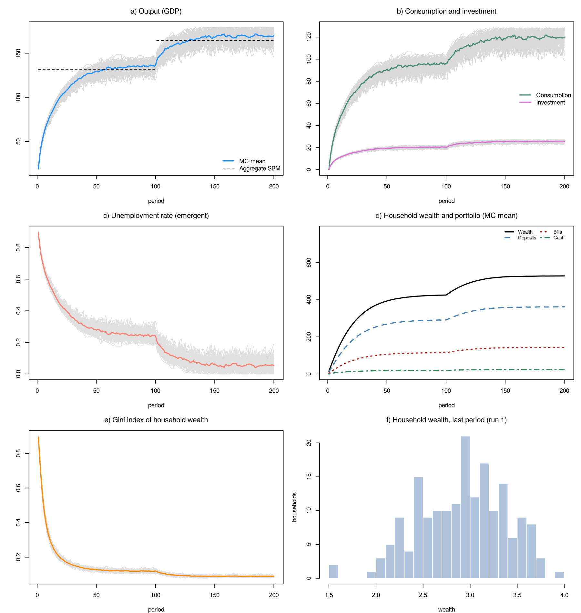
</figure>
<br>

Three results are worth highlighting.

- **Output is higher than in the aggregate model.** Mean GDP settles at about ¥136 before the shock and ¥170 after it, against ¥132 and ¥165 in Model SBM. When hiring falls short, households are rationed and cannot spend all they planned. The unspent income becomes **involuntary saving**, so that household wealth is higher (about ¥424 against ¥368). Through the fiscal anchor, more wealth means more interest-bearing assets and more consumption out of wealth, and hence higher national income. Without frictions and heterogeneity ($s = 0$ and identical households), GDP is about ¥133 and ¥166. This is close to, but not exactly equal to, the aggregate result, because households consume out of last period's income and jobs come in whole units.
- **Involuntary unemployment emerges.** Labour demand is determined by effective demand, not by the number of households willing to work, and the unemployment rate settles at about 24% before the shock and 5% after it. The level of the unemployment rate depends on the size of the workforce, which is a parameter, but its fluctuations and its response to fiscal policy are generated by the model.
- **Wealth inequality emerges.** Households differ in their propensities to consume and in their luck in the job lottery, so that their wealth differs too. The Gini index of household wealth settles at about 0.12 before the shock and falls to about 0.09 after it, because more households are employed. Figure 18 shows how the wealth distribution of a single run evolves over time (wealth per household is measured in ¥ on the horizontal axis).

#### Figure 18. Model ABM-SBM: the distribution of household wealth (run 1)

<figure>
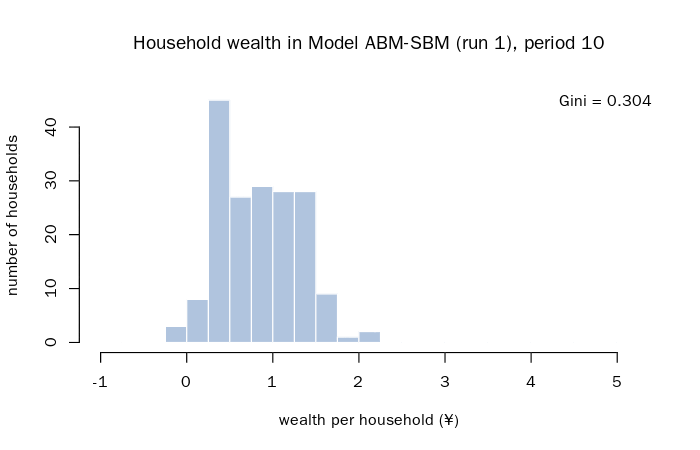
</figure>
<br>

### 5.3 - Model ABM-OPENSBM

> 📚 **Extra material.** This section extends Model ABM-SBM of Section 5.2 to the open economy, and can be skipped on a first reading.

📄 **R code:** [`4b_ABM_OPENSBM.R`](4b_ABM_OPENSBM.R)

Model **ABM-OPENSBM** (`4b_ABM_OPENSBM.R`) adds the foreign sector of Model OPENSBM-FLEX to Model ABM-SBM. Each household now also chooses how much to hold in foreign bills, and receives interest and capital gains on them, while exports, imports, the current account and the exchange rate are aggregate. Imports cover part of planned demand, so that only the rest requires domestic workers, and the goods available to the queue of buyers include imported goods.

Figure 19 shows the results. The macroeconomic behaviour is similar to that of Model OPENSBM-FLEX, with the same upward bias as in Model ABM-SBM: mean GDP is about ¥136 before the shock and ¥170 after it, and the exchange rate settles at about 1.23 and 1.42, against 1.19 and 1.37 in the aggregate model. Since income is higher, imports are higher too, and a larger depreciation is needed to balance the current account. Unemployment and wealth inequality behave as in the closed economy.

#### Figure 19. Model ABM-OPENSBM: Monte Carlo results

<figure>
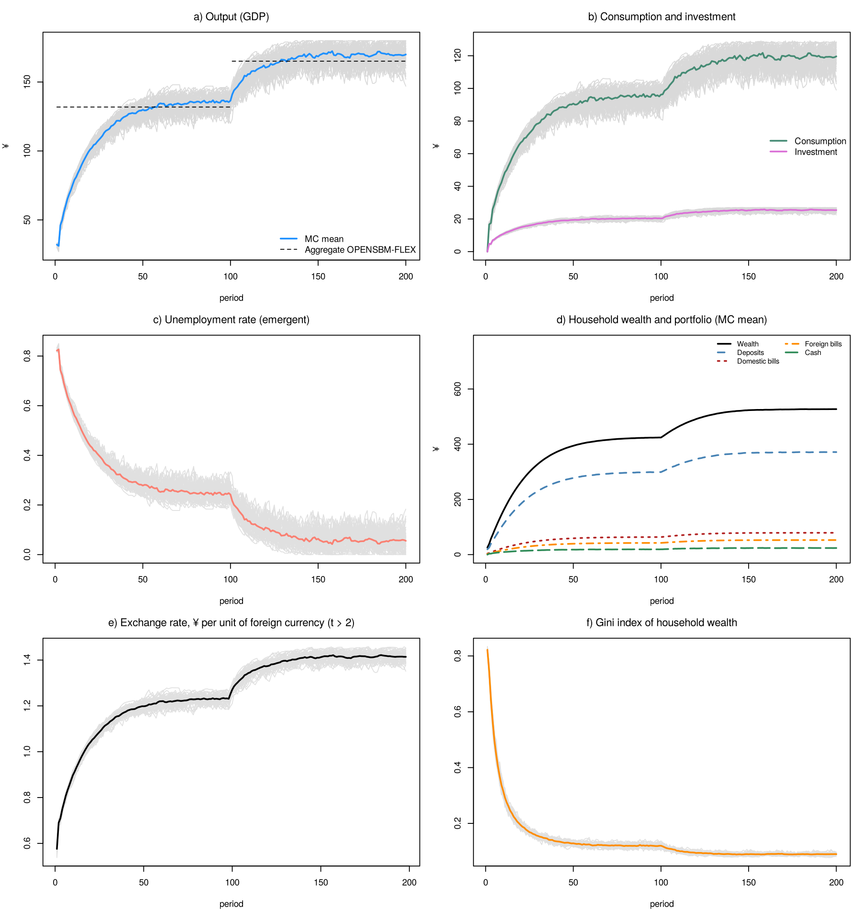
</figure>
<br>

> ### ✏️ Box M - Exercises with the agent-based models
>
> 1. **Back to the aggregate model.** In `4a_ABM_SBM.R`, set `s <- 0` and `alpha1d <- 0`. How close are the results to those of Model SBM? Why are they not identical?
> 1. **More friction.** Set `s <- 0.3`. What happens to the dispersion of the Monte Carlo runs, to mean GDP and to household wealth? Why does more friction lead to *higher* output?
> 1. **More heterogeneity.** Set `alpha1d <- 0.2`. What happens to the Gini index? And to mean GDP?
> 1. **A larger workforce.** Set `nHouseholds <- 250`. What happens to the unemployment rate and to GDP? What does this tell you about the nature of unemployment in the model?
>
> 👉 **Answers:** [here](ANSWERS.md#box-m---agent-based-models).

---

## 6 - Calibration and estimation

> 📚 **Extra material.** This section discusses how the models presented so far can be anchored to real-world data, and can be skipped on a first reading.

The models presented so far are **theoretical**: their coefficients have been chosen to produce a sensible baseline, not to describe a specific economy. To use them for policy analysis, their coefficients must be anchored to real-world data. This section explains, in simple terms, how this can be done for the SFC block (Section 6.1), the IO block (Section 6.2) and the agent-based models (Section 6.3).

There are three main ways of choosing the coefficients of an SFC model:

1. **Fine-tuning**: coefficients are chosen to achieve a specific baseline, drawing on previous studies or selecting values from a reasonable range. This is what we have done so far.
1. **Calibration**: coefficients are set so that the model reproduces selected features of the observed data, such as average ratios or a given steady state.
1. **Estimation**: coefficients are estimated from observed time series using econometric methods.

In practice, most empirical SFC models combine all three. It is also useful to distinguish between two types of empirical SFC models. *Type I* models are built from the data: their sectors and instruments follow the sectoral balance sheets and flow-of-funds statistics of the economy under investigation ([Zezza and Zezza, 2019](#references)). *Type II* models start from a theoretical model, like the ones in this repository, and the data are reclassified to match its structure (see [Section 5](https://github.com/marcoverpas/Six_lectures_on_sfc_models#5_making_it_empirical) of the Six lectures on SFC models, where Model PC is estimated on Italian data using the `R` package `bimets`). Type I models are more accurate. Type II models are smaller and their results easier to interpret.

### 6.1 - The SFC block

The coefficients of the SFC block can be divided into three groups, which are identified in different ways.

**Ratios and accounting coefficients.** Many coefficients are simply ratios between observed variables, and can be calibrated by taking their average over a period of time. In Model SBM, the tax rate is the ratio between taxes and taxable income, $\theta = T / (WB + F_b + r_{b,-1} \cdot B_{h,-1} + r_{m,-1} \cdot M_{h,-1})$; the depreciation rate is the ratio between depreciation and the capital stock, $\delta = DA / K_{-1}$; the cash ratio is $\lambda_c = H_h / C_{-1}$; and interest rates are either observed directly or recovered from the accounts (see below). The data come from the national accounts (flows) and the financial accounts (stocks and financial flows), which are organised in the same way as the transactions-flow and balance-sheet matrices of Sections 1.2 and 2.

**Which data?** The natural source for an SFC model is the **System of National Accounts** (SNA), the international standard for national accounts. Most countries currently compile their accounts following the 2008 SNA (in the European Union, its counterpart, the ESA 2010), while the 2025 SNA, adopted by the United Nations Statistical Commission in March 2025, will be implemented in the coming years. What matters for SFC modelling are not the aggregate GDP figures, but the **institutional sector accounts**, which record the transactions, stocks and revaluations of each sector of the economy: non-financial corporations (S.11), financial corporations (S.12, including the central bank, S.121, and deposit-taking corporations, S.122), general government (S.13), households and non-profit institutions serving households (S.14-S.15), and the rest of the world (S.2). They consist of three blocks, which correspond to the matrices of an SFC model: the **non-financial accounts** (income, consumption, saving and investment), which feed the upper part of the transactions-flow matrix; the **financial accounts** (transactions in financial instruments), which feed its lower part; and the **financial balance sheets**, which feed the balance-sheet matrix. In the national accounts, holding gains and losses are recorded in a separate **revaluation account** (K.7). Most SFC models have no such account: holding gains and losses are added directly to the change in wealth, as in Model OPENSBM-FLEX (Section 2.2). In China, sectoral flows are published as flow-of-funds accounts, both for non-financial and for financial transactions. Table 13 matches the main variables of Model OPENSBM-FLEX with the corresponding SNA items. In a Type II model, this matching requires some reclassification: for instance, the households and non-profit institutions of the SNA must be merged into a single sector, and instruments that are not in the model (such as equities or insurance reserves) must be either added to the model or merged with the closest instrument.

#### Table 13. Model variables and SNA items (2008 SNA codes)

| Model variable | SNA item | Sectors involved |
|:---------------|:---------|:-----------------|
| $C$ | Final consumption expenditure (P.3) | Households (S.14-S.15) |
| $G$ | Final consumption expenditure (P.3), possibly plus gross fixed capital formation (P.51g) | General government (S.13) |
| $I$ | Gross fixed capital formation (P.51g) | Non-financial corporations (S.11) |
| $DA$, $AF$ | Consumption of fixed capital (P.51c) | Non-financial corporations (S.11) |
| $WB$ | Compensation of employees (D.1) | S.11 to S.14 |
| $T$ | Current taxes on income, wealth, etc. (D.5) | S.14 to S.13 |
| Interest flows | Interest (D.41) | All sectors |
| $F_b$, $F_{cb}$ | Distributed income of corporations (D.42) | S.122 to S.14; S.121 to S.13 |
| $YD$ | Disposable income (B.6) | Households (S.14-S.15) |
| $PSBR$ | Net borrowing, i.e. net lending (+) / net borrowing (-) with the sign reversed (B.9) | General government (S.13) |
| $H$ | Currency (F.21 for flows, AF.21 for stocks) | S.121 to S.14 |
| $M$ | Transferable and other deposits (F.22 and F.29; AF.22 and AF.29) | S.122 to S.14 |
| $B$ | Debt securities (F.3; AF.3) | Issued by S.13 |
| $L$ | Loans (F.4; AF.4) | S.122 to S.11 |
| $K$ | Fixed assets (AN.11), net stock | Non-financial corporations (S.11) |
| $X$, $IM$ | Exports and imports of goods and services (P.6, P.7) | Rest of the world (S.2) |
| $CA$ | Current external balance (B.12) | Rest of the world (S.2) |
| $NETFA$ | Net international investment position | Rest of the world (S.2) |
| $CG$ | Nominal holding gains and losses (K.7) | Revaluation account |

**From the sector accounts to the model matrices.** In practice, the matrices are built one sector at a time. The column of each sector in the transactions-flow matrix is filled from its non-financial and financial accounts, and its column in the balance-sheet matrix from its financial balance sheet (in the European Union, for instance, the Eurostat datasets `nasa_10_nf_tr` and `nasa_10_f_bs`). Since a small model includes only a few transactions and instruments, the remaining items are merged into two residual entries: **other payments**, such as other property income (D.43-D.45), capital transfers (D.9) and the acquisition of non-produced assets (NP), in the transactions-flow matrix; and **other financial assets**, such as insurance and pension reserves (AF.6), derivatives (AF.7) and other accounts (AF.8), in the balance-sheet matrix. Each residual is calculated as the difference between the balancing item of the sector (net lending, B.9, or net financial worth, BF.90) and the entries that are modelled explicitly, so that every column sums to zero by construction. Rows can be closed in the same way: when the data for one sector are missing or unreliable, its entry can be obtained as minus the sum of the entries of the other sectors. This guarantees that the model has no "black holes", but residual entries also absorb measurement errors and statistical discrepancies. They should therefore be kept small, modelled in a parsimonious way (for instance, as exogenous variables or simple autoregressive processes) and not given a behavioural interpretation.

**Saving and changes in wealth.** A common problem in moving from the data to the model is that the change in the net wealth of a sector is not equal to its net lending. In the model, $\Delta V = NL + CG$, so that the gap, $CG = \Delta V - NL$, is usually calculated residually from the data. It includes holding gains and losses (K.7), such as changes in the prices of shares and bonds, as well as other changes in the volume of assets (K.1-K.6), such as debt write-offs and reclassifications, and often the statistical discrepancy between net lending in the non-financial accounts (B.9) and in the financial accounts (B.9F). This gap can be large and volatile, especially for households and the rest of the world. It can either be modelled explicitly, for instance as a return on the stock of shares or, as in Model OPENSBM-FLEX, as the revaluation of foreign assets when the exchange rate changes, or be treated as exogenous in the simulations. What must be avoided is ignoring it: if wealth is accumulated from net lending alone, the simulated stocks drift away from the observed ones, and so do the flows, such as interest payments, that depend on them.

**Behavioural coefficients.** The coefficients of behavioural equations, such as the propensities to consume, are estimated by regression. Consider the consumption function of Model SBM, $C = \alpha_1 \cdot YD + \alpha_2 \cdot V_{-1}$. Given time series for consumption, disposable income and wealth, $\alpha_1$ and $\alpha_2$ can be estimated by ordinary least squares (OLS). Real data raise several issues: the variables are trending and often non-stationary, which calls for cointegration or error-correction methods; consumption and income are determined simultaneously, which can bias OLS estimates; and samples are often short. Dedicated packages, such as `bimets`, allow estimating and simulating systems of equations with these issues in mind.

**Error correction models.** When the variables are non-stationary but move together in the long run (that is, they are *cointegrated*), standard OLS on the levels can be complemented with an **error correction model** (ECM), which separates the long-run relationship from the short-run dynamics ([Engle and Granger, 1987](#references)). For the consumption function, the long-run relationship is the one of Model SBM, $C = \alpha_1 \cdot YD + \alpha_2 \cdot V_{-1}$, while the short-run equation is:

$$\Delta C = b_0 + b_1 \cdot \Delta YD - \Phi \cdot (C_{-1} - \alpha_1 \cdot YD_{-1} - \alpha_2 \cdot V_{-2}) + u$$

where $u$ is the error term, the term in brackets is the gap between consumption and its long-run level in the previous period, and $\Phi$, between zero and one, measures how quickly consumption closes it. In the simplest (two-step) procedure, the long-run coefficients are first estimated by OLS on the levels, and the lagged residuals are then used as the error-correction term in an OLS regression on the differences. The ECM can be included in the model as it stands: rewritten in levels, it gives $C$ as a function of past consumption, current and past income and past wealth, and stock-flow consistency is preserved, since consumption still determines saving and wealth through the budget constraint of households.

In empirical SFC models, the ECM is often estimated in a single step. In levels, the equation is:

$$\Delta C = \Gamma_0 + \Gamma_1 \cdot \Delta YD + \Gamma_2 \cdot C_{-1} + \Gamma_3 \cdot YD_{-1} + \Gamma_4 \cdot V_{-2} + u$$

It is linear in the coefficients, and can be estimated by OLS. The speed of adjustment is $\Phi = -\Gamma_2$, and the coefficients of the long-run relationship are recovered afterwards as $\alpha_1 = -\Gamma_3 / \Gamma_2$ and $\alpha_2 = -\Gamma_4 / \Gamma_2$, so that they map directly onto the propensities of the model. Two practical points are worth noting. First, a negative and significant $\Gamma_2$ is evidence that a long-run relationship exists, but its *t*-statistic must be compared with specific critical values for cointegration tests, which are larger in absolute value than the usual ones. Second, as noted above, the current change in disposable income is determined together with consumption, so that OLS estimates can be biased. Using lagged changes, or instrumenting the current change with its own lags, reduces the problem.

When the variables are trending, the levels version has a drawback: the size of the errors grows with the size of the variables, which in turn grow with the economy (*heteroscedasticity*). OLS estimates of the coefficients remain unbiased, but their standard errors, and therefore the tests, become unreliable. The usual remedy is to estimate the equation in **log-levels**:

$$\Delta \log C = \Gamma_0 + \Gamma_1 \cdot \Delta \log YD + \Gamma_2 \cdot \log C_{-1} + \Gamma_3 \cdot \log YD_{-1} + \Gamma_4 \cdot \log V_{-2} + u$$

where the errors are proportional rather than absolute deviations. This comes at a cost. The long-run relationship becomes multiplicative, $\log C = e_0 + e_1 \cdot \log YD + e_2 \cdot \log V$, with long-run elasticities $e_1 = -\Gamma_3 / \Gamma_2$ and $e_2 = -\Gamma_4 / \Gamma_2$, which do not map directly onto $\alpha_1$ and $\alpha_2$. Logs also cannot be used for variables that may be zero or negative, such as net lending or the net wealth of some sectors. And, in a growing economy, the consumption-income ratio is stable in the long run only if $e_1 + e_2 = 1$. If the estimates do not satisfy this condition, the restriction $\Gamma_2 + \Gamma_3 + \Gamma_4 = 0$ can be imposed. Alternatively, the equation can be kept in levels and divided through by lagged disposable income, or estimated with heteroscedasticity-robust standard errors.

**Steady-state restrictions.** Finally, some coefficients can be pinned down by the steady state of the model. For instance, in the stationary state of Model SBM, consumption is equal to disposable income, so that the consumption function implies $V / YD = (1 - \alpha_1) / \alpha_2$. Given an estimate of $\alpha_1$ and the observed wealth-to-income ratio, $\alpha_2$ follows. In our baseline, $V / YD \approx 4$, which is consistent with $\alpha_1 = 0.6$ and $\alpha_2 = 0.1$.

**Portfolio equations and interest rates.** Two further difficulties are worth mentioning. First, estimating portfolio equations is always a challenge. The shares of the different assets in household wealth depend on relative rates of return, which change little and are strongly correlated with one another, while the adding-up constraint (the shares must sum to one) must be respected by the estimated coefficients. As a result, portfolio coefficients are often calibrated rather than estimated. Second, setting or estimating the interest rates of the model is also complicated. In the accounts, stocks are recorded *ex post*, at the end of each period, while interest payments depend on what happens *within* the period: on the stocks actually outstanding at each moment, which change with new issues and repayments, and on the rates applied to them, which may change during the period. The ratio between the interest flows and the stocks at the end of the previous period, which is what the model uses, is therefore only an approximation of the effective interest rate, and it should be compared with the interest rates published by the central bank.

#### 🛠️ Hands-on: recovering the propensities to consume

A good way to understand estimation is to apply it to data generated by a model whose coefficients we know. The code below runs Model SBM with random shocks to government spending, adds a small measurement error to consumption, and estimates the consumption function by OLS on periods 51-200:

```r
src <- readLines("1a_SBM.R")
src <- src[1:(grep("^# Display the results", src)[1] - 1)]   # drop displays and plots
src <- sub("^nScenarios\\s*<-.*", "nScenarios <- 1", src)       # one scenario
src <- sub("if \\(i >= shockStart && j == 2\\) G0\\[j, i\\] <- Gshock.*",
           "G0[j, i] <- 20 * exp(rnorm(1, 0, 0.05))", src)       # random fiscal shocks
set.seed(1); eval(parse(text = src))
t    <- 51:200
Cobs <- C[1, t] * exp(rnorm(length(t), 0, 0.005))             # "observed" consumption
summary(lm(Cobs ~ 0 + YD[1, t] + V[1, t - 1]))
```

The estimated coefficients are about 0.58 for $\alpha_1$ (standard error 0.02) and 0.104 for $\alpha_2$ (standard error 0.005), close to the true values of 0.6 and 0.1. Without the random fiscal shocks, the economy would sit in its steady state, and there would be no variation to exploit: a coefficient can only be estimated if the data contain enough variation to reveal it.

### 6.2 - The IO block

The coefficients of the IO block are mostly **calibrated** from input-output tables, which national statistical offices compile from detailed surveys. In China, the National Bureau of Statistics compiles benchmark IO tables every five years, in years ending in 2 and 7, and extension tables, based on the benchmark tables and other statistical information, in years ending in 0 and 5. Multi-country databases, such as the OECD Inter-Country Input-Output tables, are useful for open-economy models. For examples of empirically calibrated IO-SFC models, see [Fevereiro et al. (2024)](#references), who use a 54-industry model of the European Union and the rest of the world, and [Veronese Passarella (2025a)](#references), who uses a 20-industry model of Italy (both are discussed in Section 5 of the [Florence keynote speech](https://github.com/marcoverpas/keynote_speech_Florence#5---more-advanced-models)). [Canelli et al. (2026)](#references) extend the latter to 163 industries, using the 2021 Exiobase tables, and reconcile the IO and the SFC data by splitting imports into an intermediate and a final component.

**Technical coefficients.** As shown in Box F, the technical coefficients are obtained by dividing each intermediate flow by the gross output of the industry that uses it, $a_{ij} = z_{ij} / x_j$. Since IO tables are in monetary terms, these coefficients are not physical: they are ratios between values, which change when relative prices change, even if the technique of production does not. Deflating the tables with industry-specific price indices reduces, but does not remove, this problem. IO tables that distinguish between domestic and imported inputs give both $\mathbf{A}$ and the matrix of imported-input coefficients, $\mathbf{A}_m$.

**Level of detail and aggregation.** The models in this repository have only three industries because they are teaching tools. In empirical work, the level of disaggregation should be dictated by the research question, not by convenience. The safest strategy is to start from the most disaggregated data available (more than 100 industries in the Chinese benchmark tables, 163 industries per country in Exiobase), and to aggregate them only if, and as far as, the question requires: aggregation can always be done later, while detail lost at the start cannot be recovered. When aggregation is needed, industries are aggregated by summing the corresponding rows and columns of the table *before* computing the coefficients. With an aggregation matrix $\mathbf{Q}$, whose element $q_{kj}$ is equal to one if the detailed industry $j$ belongs to the aggregate industry $k$ and to zero otherwise, the aggregated flows are $\mathbf{Z}^{agg} = \mathbf{Q} \cdot \mathbf{Z} \cdot \mathbf{Q}^T$ and $\mathbf{x}^{agg} = \mathbf{Q} \cdot \mathbf{x}$.

**Final demand and trade shares.** The composition shares $\boldsymbol{\beta}_C$, $\boldsymbol{\beta}_I$ and $\boldsymbol{\beta}_G$ are the columns of final demand (household consumption, gross fixed capital formation and government consumption), each divided by its total. The export shares $\boldsymbol{\chi}$ are obtained in the same way from the export column, and the import contents $\boldsymbol{\psi}$ from the comparison between the import and total use tables.

**Labour, capital and prices.** Labour coefficients are employment by industry divided by gross output, $l_j = N_j / x_j$, and capital intensities are capital stocks by industry divided by gross output, $\kappa_j = K_j / x_j$. In a Sraffa-like closure, the mark-up factors can be calibrated from the base-year price equations. If prices are normalised to one in the base year, the price equation of Section 3.3 becomes $1 = m_j \cdot \sum_i a_{ij} + w \cdot l_j$, so that $m_j = (1 - w \cdot l_j) / \sum_i a_{ij}$. In words, with all prices equal to one, $1 - w \cdot l_j$ is what is left of each unit of revenue after paying wages, and $\sum_i a_{ij}$ is the cost of the intermediate inputs needed to produce that unit: the calibrated mark-up factor is the ratio between the two, given the observed wage and the observed coefficients.

**Ecological coefficients.** Energy, emission and material intensities are obtained by dividing energy use, emissions and material extraction by industry, from environmentally-extended IO tables, energy balances or material flow accounts, by gross output.

**From three to $n$ industries.** The equations of the IO models are written in vector and matrix form, so they do not depend on the number of industries. However, turning a three-industry model into an $n$-industry one takes more than changing `nIndustries`:

1. **Read the coefficients from files, and let the data set the dimension.** Typing a $163 \times 163$ matrix by hand is not an option. Moreover, `R` silently *recycles* a vector that is too short when the number of industries is a multiple of its length (for instance, a three-element vector of capital intensities in a six-industry model), so that a wrong dimension may produce wrong results without any error message. Explicit checks prevent this (see the code below).
1. **Calibrate everything from the same table and base year.** The composition shares must sum to one, and the totals of the IO final-demand columns must match the aggregates of the macroeconomic block ($C$, $I$, $G$, $X$, $IM$). IO tables are usually valued at basic prices, so that the sum of value added across industries is equal to GDP only after adding taxes less subsidies on products, which are absent from our models: they must be either added to the model or included in value added.
1. **Deal with empty industries.** Multi-regional tables, such as Exiobase, include industries with zero or negligible output in some countries. Since technical, labour and capital coefficients are all divided by gross output, these industries must be dropped or merged with similar ones, and $(\mathbf{I} - \mathbf{A})$ must be invertible.
1. **Check the calibrated mark-ups.** With Sraffa-like prices, mark-ups calibrated from base-year prices can turn out negative or implausibly large in industries where labour costs are close to revenue, or where output is largely imputed. These cases are rare with three industries, but common with many.
1. **Rewrite the scenarios and the output.** Experiments defined industry by industry, such as the shift in the composition of public spending of Section 3.2, must be redefined, and so must tables and charts, which in the scripts are written for three industries. With many industries, it is usually better to show aggregates or a selection of industries.

```r
A   <- as.matrix(read.csv("A.csv", row.names = 1))           # n x n technical coefficients
ind <- read.csv("industry_parameters.csv")                   # one row per industry
nIndustries <- nrow(A)
stopifnot(ncol(A) == nIndustries, nrow(ind) == nIndustries,   # dimensions must agree
          all(abs(colSums(ind[, c("betaC", "betaI", "betaG")]) - 1) < 1e-8),  # shares sum to one
          all(Mod(eigen(A)$values) < 1))                      # (I - A) is invertible and productive
pr    <- ind$pr;    kappaj <- ind$kappaj
betaC <- ind$betaC; betaI  <- ind$betaI; betaG <- ind$betaG
```

**Changing coefficients.** IO tables are not available every year, and technical coefficients change over time. Between benchmark years, coefficients can be updated with the **RAS method** (or *biproportional scaling*). Starting from an old matrix of technical coefficients, and from the row and column totals of the intermediate flows of the new year (which are usually available), the method multiplies each row of the old matrix by a factor, so that the row totals match the new ones, then each column by another factor, so that the column totals match, and repeats the two steps until both sets of totals are matched. The name comes from the notation of the original formulation, in which the old matrix is pre-multiplied by a diagonal matrix of row factors and post-multiplied by a diagonal matrix of column factors ([Miller and Blair, 2009, ch. 7](#references)).

### 6.3 - Agent-based models: moment matching

Calibrating an ABM is harder than calibrating an aggregate model. ABMs have many coefficients, their outcomes are random, and their aggregate behaviour emerges from the interaction of the agents, so that there is no simple equation linking coefficients to observed variables. For these reasons, ABMs are usually calibrated in three steps.

1. **Direct calibration.** Coefficients that have an observable counterpart are set directly. Macroeconomic coefficients can be taken from the corresponding aggregate model (Sections 6.1 and 6.2), while the distribution of individual coefficients, such as the propensities to consume, can be taken from household surveys (for China, for instance, the China Household Finance Survey or the China Family Panel Studies).
1. **Indirect calibration by moment matching.** The remaining coefficients are chosen so that the model reproduces selected statistics of the data (the *moments*), such as the average unemployment rate, the volatility of GDP growth or the Gini index of wealth. This is the **method of simulated moments** ([Franke, 2009](#references)). For each candidate set of coefficients, the model is simulated several times, the simulated moments are computed and averaged across runs, and their distance from the observed moments is measured. The coefficients that minimise the distance are selected. The same random seeds are used for all candidate coefficients (*common random numbers*), so that differences in the results reflect differences in the coefficients rather than in the random draws.
1. **Validation.** The calibrated model is checked against features of the data that were *not* used in the calibration, such as the shape of the distribution of firm sizes or the correlation between macroeconomic variables.

Since each evaluation requires many simulations, more advanced methods have been developed to make the search more efficient, such as Bayesian estimation ([Grazzini et al., 2017](#references)) and machine-learning surrogates of the model ([Lamperti et al., 2018](#references)).

---

## 7 - Concluding remarks

These lectures have built a family of models around a single benchmark, Model SBM, the simplest model in which state money and bank money coexist. Starting from it, we have added a foreign sector, an input-output structure with two alternative price closures, an ecological block, and heterogeneous households. The models are deliberately small, and their smallness is the point. Each was built **one layer at a time**, and at every step the balance-sheet and transactions-flow matrices sum to zero, and the redundant equation holds to machine precision. A model that fails this test is not "roughly right": it is leaking money somewhere, and its results cannot be trusted. **Accounting consistency**, both monetary and physical, is the non-negotiable floor beneath everything else.

Each extension has taught us something that the aggregate model could not.

- **The open economy** shows that the external constraint matters. With a floating exchange rate, the fiscal anchor still pins down national income in the long run, and the exchange rate takes care of the current account. With a fixed exchange rate, the government and the external deficits feed each other, and the economy cannot reach a stationary state.
- **The input-output structure** shows that the *composition* of demand matters, not only its level. Through industry-specific capital intensities, a shift of demand between industries changes investment and national income for 20 to 40 periods, and with Sraffa-like prices it changes relative prices and the distribution of income. In the open economy, the pass-through of the exchange rate to domestic prices turns a fiscal expansion into a permanent fall in the real wage.
- **The ecological block** shows the basic dilemma of ecological macroeconomics: in the absence of structural change, more output means more energy, more emissions and more warming, and physical constraints apply whatever happens to monetary variables. It also shows how much the results depend on the choice of feedback from the ecosystem to the economy.
- **The agent-based households** show that heterogeneity and interaction generate outcomes that no household was told to produce: involuntary unemployment, rationing and wealth inequality. In our models, frictions *raise* output in the long run, because involuntary saving increases wealth and, through the fiscal anchor, national income: a result that contrasts with that of the agent-based Model BMW of the Leeds lectures, where the investment accelerator dominates.

The models also have clear **limitations**, which define the agenda for further work. In all of them, the long run is dominated by the fiscal anchor, as in Godley and Lavoie's simplest models: there are no retained profits, no equities, no inflation process and no endogenous technical change. Technical coefficients and composition shares are fixed, imports are determined at the aggregate level, and firms are not heterogeneous. The ecological block is calibrated on stylised world magnitudes, and the climate feedback is purely illustrative. Each of these limitations can be removed, but each extension should be justified by a research question.

This is the more general lesson. **Complexity should always have to justify itself.** Input-output detail earns its place when the question is about industrial interdependence, structural change, relative prices, or the propagation of a sectoral shock. An ecological block earns its place when the question requires an explicit account of the relationship between the economy and the ecosystem. Agent-based microfoundations earn their place when heterogeneity and interaction genuinely produce emergent macroeconomic behaviour. When the question does not require these extensions, the aggregate model is not a poorer answer but the right one. The art is matching the resolution of the model to the resolution of the question, and no finer. Once this choice has been made, the model can be anchored to the data, as discussed in Section 6, and used to study a specific economy, such as China's.

Lastly, a few words on **Artificial Intelligence** (AI). AI is transforming the way in which we develop these models. It writes and debugs code, checks consistency, ports a model from one language to another, and allows researchers to explore in a few hours what once took weeks. This is a genuine gain, and these lectures could not have been prepared so quickly without it. However, AI carries a real danger: the ease of generating ever larger and more intricate models tempts us to mistake complication for insight. A model that nobody can fully read, whose mechanisms are buried under thousands of automatically generated lines of code, is a **black box**, and a black box does not deepen our understanding of economic, financial, social and environmental phenomena. AI should be **used to simplify**: to strip a model down to its essential mechanisms, to make its logic transparent, and to let us see clearly why a result holds.

If SFC, IO, agent-based and other monetary-production approaches are to offer a credible alternative to mainstream methods, it will not be by matching them in mathematical elaboration. It will be by offering models that are fully consistent, economically transparent, and no more complex than the question requires: models that a student can open, read and understand.

> ### 📦 Box N - Further material
>
> The companion repositories listed in the [Overview](#overview) cover what these lectures leave out:
>
> - [Leeds lectures](https://github.com/marcoverpas/Leeds_lectures_2026): the toy models (SIM, PC, BMW) in aggregate, input-output and agent-based form;
> - [Six lectures on SFC models](https://github.com/marcoverpas/Six_lectures_on_sfc_models): multi-area and empirical models;
> - [Macerata PhD lectures](https://github.com/marcoverpas/PhD_Lectures_Macerata_2025): the links between SFC models and the monetary circuit theory;
> - [EAEPE Summer School](https://github.com/marcoverpas/EAEPE_summer_school_2024) and [Florence keynote speech](https://github.com/marcoverpas/keynote_speech_Florence): ecological SFC models.

---

## References

- Berg, M., Hartley, B., and Richters, O. (2015). **A stock-flow consistent input-output model with applications to energy price shocks, interest rates, and heat emissions**. *New Journal of Physics*, 17, 015011.
- Caiani, A., Russo, A., Palestrini, A., and Gallegati, M. (eds.) (2016). **Economics with Heterogeneous Interacting Agents: A Practical Guide to Agent-Based Modeling**. New Economic Windows, Springer, Cham.
- Canelli, R., Fontana, G., Realfonzo, R., Sala, E., and Veronese Passarella, M. (2026). **Financing the Green Transition in Italy: Evidence from an Empirically Calibrated IO-SFC Model**. Paper presented at the International Conference on Ecological Macroeconomics (ICEM 2026), University of Florence, 10-12 September 2026.
- Carnevali, E. (2022). **A New, Simple SFC Open Economy Framework**. *Review of Political Economy*, 34 (3): 504-533.
- Carnevali, E., Deleidi, M., Pariboni, R. and Veronese Passarella, M. (2019). **Stock-Flow Consistent Dynamic Models: Features, Limitations and Developments**. In P. Arestis and M. Sawyer (eds.), *Frontiers of Heterodox Macroeconomics*, International Papers in Political Economy, Palgrave Macmillan, Cham, pp. 223-276.
- Caverzasi, E., and Godin, A. (2015). **Post-Keynesian stock-flow-consistent modelling: a survey**. *Cambridge Journal of Economics*, 39 (1): 157-187.
- Copeland, M. A. (1949). **Social accounting for moneyflows**. *The Accounting Review*, 24 (3): 254-264.
- Cusbert, T., and Kendall, E. (2018). **[Meet MARTIN, the RBA's New Macroeconomic Model](https://www.rba.gov.au/publications/bulletin/2018/mar/meet-martin-the-rbas-new-macroeconomic-model.html)**. *Reserve Bank of Australia Bulletin*, March 2018.
- Dafermos, Y., Nikolaidi, M., and Galanis, G. (2017). **A stock-flow-fund ecological macroeconomic model**. *Ecological Economics*, 131: 191-207.
- Dafermos, Y., Nikolaidi, M., and Galanis, G. (2018). **Climate change, financial stability and monetary policy**. *Ecological Economics*, 152: 219-234.
- Engle, R. F., and Granger, C. W. J. (1987). **Co-integration and error correction: Representation, estimation, and testing**. *Econometrica*, 55 (2): 251-276.
- Fevereiro, J. B. R. T., Genovese, A., Purvis, B., Valles Codina, O., and Veronese Passarella, M. (2025). **Macroeconomic Models for Assessing the Transition towards a Circular Economy: A Systematic Review**. *Ecological Economics*, 236, 108669.
- Fevereiro, J. B. R. T., Genovese, A., Valles Codina, O., and Veronese Passarella, M. (2024). **Scenario Analysis. Policy Briefs**. JUST2CE Project, Deliverable D5.3.
- Franke, R. (2009). **Applying the method of simulated moments to estimate a small agent-based asset pricing model**. *Journal of Empirical Finance*, 16 (5): 804-815.
- Georgescu-Roegen, N. (1971). **The Entropy Law and the Economic Process**. Harvard University Press.
- Godley, W. (1999). **Seven Unsustainable Processes: Medium-Term Prospects and Policies for the United States and the World**. Special Report, Levy Economics Institute of Bard College.
- Godley, W., and Lavoie, M. (2007). **Monetary Economics: An Integrated Approach to Credit, Money, Income, Production and Wealth**. Palgrave Macmillan.
- Grazzini, J., Richiardi, M. G., and Tsionas, M. (2017). **Bayesian estimation of agent-based models**. *Journal of Economic Dynamics and Control*, 77: 26-47.
- Hardt, L., and O'Neill, D. W. (2017). **Ecological macroeconomic models: Assessing current developments**. *Ecological Economics*, 134: 198-211.
- Jackson, T., and Victor, P. A. (2015). **Does credit create a 'growth imperative'? A quasi-stationary economy with interest-bearing debt**. *Ecological Economics*, 120: 32-48.
- Lamperti, F., Roventini, A., and Sani, A. (2018). **Agent-based model calibration using machine learning surrogates**. *Journal of Economic Dynamics and Control*, 90: 366-389.
- Leontief, W. W. (1936). **Quantitative input and output relations in the economic systems of the United States**. *The Review of Economics and Statistics*, 18 (3): 105-125.
- Lorenz, E. N. (1963). **Deterministic nonperiodic flow**. *Journal of the Atmospheric Sciences*, 20 (2): 130-141.
- Matthews, H. D., Gillett, N. P., Stott, P. A., and Zickfeld, K. (2009). **The proportionality of global warming to cumulative carbon emissions**. *Nature*, 459 (7248): 829-832.
- Miller, R. E., and Blair, P. D. (2009). **Input-Output Analysis: Foundations and Extensions**. Cambridge University Press, 2nd edition.
- Nikiforos, M., and Zezza, G. (2017). **Stock-flow Consistent Macroeconomic Models: A Survey**. *Journal of Economic Surveys*, 31 (5): 1204-1239.
- Pettena, M., and Raberto, M. (2025). **Energy transition and structural change: A calibrated Stock-Flow Consistent Input-Output model**. *Structural Change and Economic Dynamics*, 75: 949-995.
- Reynolds, C. W. (1987). **Flocks, herds and schools: A distributed behavioral model**. *Computer Graphics*, 21 (4): 25-34.
- Sraffa, P. (1960). **Production of Commodities by Means of Commodities: Prelude to a Critique of Economic Theory**. Cambridge University Press.
- Thomsen, S. F., Raza, H., and Byrialsen, M. R. (2025). **An assessment of carbon taxation policies: The case of Denmark**. *Ecological Economics*, 238, 108741.
- Tobin, J. (1982). **Money and finance in the macroeconomic process**. *Journal of Money, Credit and Banking*, 14 (2): 171-204.
- Veronese Passarella, M. (2023). **Technical change and the monetary circuit: an input-output stock-flow consistent dynamic model**. *Quaderni del Dipartimento di Economia Politica e Statistica, Università di Siena*, n. 903.
- Veronese Passarella, M. (2025a). **An Empirically Calibrated IO-SFC Model for Assessing Green Transition Policies in Italy**. Working paper presented at the MADME Conference, Venice, 29-30 May 2025.
- Veronese Passarella, M. (2025b). **Destabilizing a Stable Economy: Minsky Meets Graziani's Monetary Circuit**. *International Journal of Political Economy*, 54 (3): 338-355.
- Zezza, F. (2026). **OPENSIMPLEST: The Smallest SFC Open Economy Model**. Levy Economics Institute of Bard College, [Working Paper No. 1105](https://www.levyinstitute.org/publications/opensimplest-the-smallest-sfc-open-economy-model/).
- Zezza, G., and Zezza, F. (2019). **On the design of empirical stock-flow consistent models**. *European Journal of Economics and Economic Policies: Intervention*, 16 (1): 134-158.
